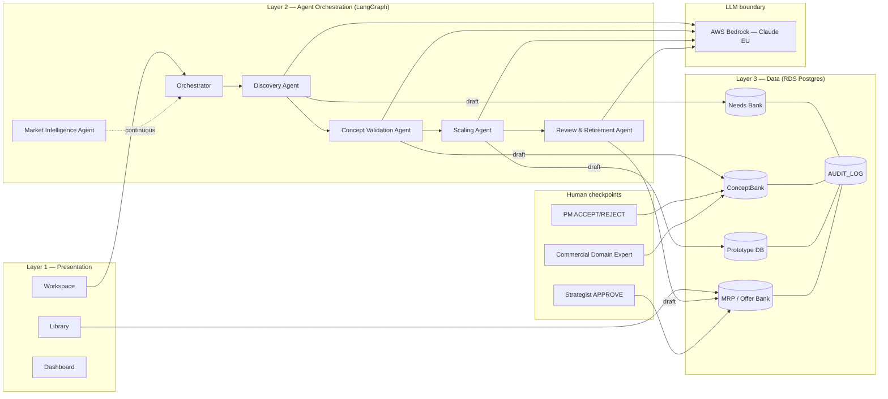
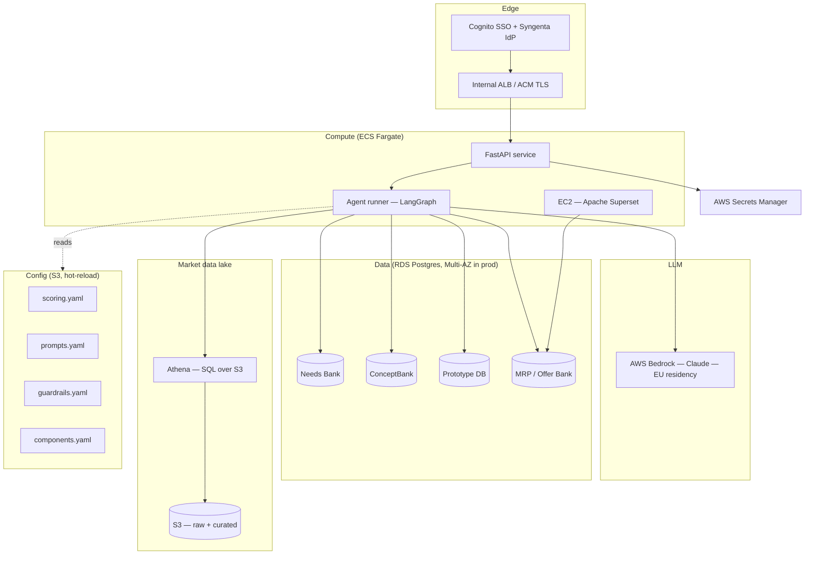
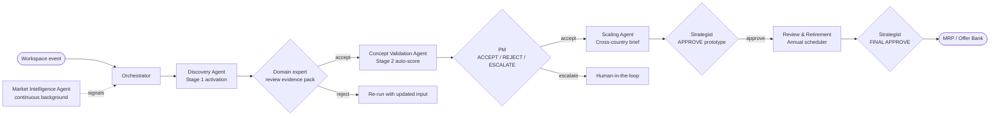
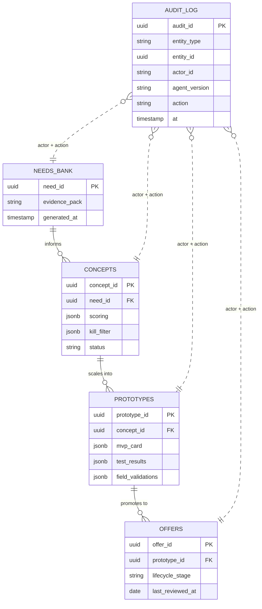

# 2. Technical Architecture & Wiring

> **Source:** Confluence page `5679775984` in space `DODE`
> **Original URL:** <https://digitial-product-engineering.atlassian.net/wiki/spaces/DODE/pages/5679775984>
> **Diagrams:** all original PNG diagrams are inlined as Mermaid below.

---

This document defines the full technical architecture of the Differentiated Offers platform - the agent-orchestrated system for offer development, validation, and lifecycle management across Syngenta's European commercial operations.

**Document Scope**

This page covers: layered system architecture, 6-agent design with autonomy boundaries, 4-database data layer, integration landscape, agentic data flows, tech stack decisions, and security model.

# 1. Architecture Overview

The platform is structured across five layers, each with a distinct responsibility boundary.

**Design Principle**

Agents operate asynchronously against persistent databases. No agent blocks the commercial team's workflow. Human gates exist at defined points; all other processing is autonomous.

| Layer | Name | Components | Responsibility |
| --- | --- | --- | --- |
| **Layer 1** | Presentation | Workspace, Library, Dashboard | User-facing surfaces. Workspace = per-offer project environment. Library = shared databases (Needs Bank, ConceptBank, Offer Bank). Dashboard = leadership portfolio view with cross-workspace analytics. |
| **Layer 2** | Agent Orchestration | Orchestrator Agent + 5 Specialist Agents | All intelligence and automation. Each agent has defined tools, memory context, and hard autonomy boundaries. Orchestrator routes events; specialist agents execute domain tasks. |
| **Layer 3** | Data | Needs Bank, ConceptBank, Prototype DB, MRP/Offer Bank DB | Four AWS RDS (PostgreSQL) databases. Persistent structured storage for all offer development data, validation records, and live offer portfolio. |
| **Layer 5** | Infrastructure | AWS RDS, AWS EC2/Superset, AWS Bedrock | Data storage (RDS), dashboard hosting (EC2 + Apache Superset), LLM inference for agents (AWS Bedrock, Claude, EU data residency). |

# 2. Agent Architecture

Six agents operate within the orchestration layer. Each is defined by purpose, tool set, autonomous action boundaries, and human escalation triggers.

## 2.1 Orchestrator Agent

| Attribute | Detail |
| --- | --- |
| **Purpose** | Routes events between agents, maintains workspace state, handles interrupts, escalates to humans when criteria are met. |
| **Tools** | workspace state reader, agent spawner, human escalation trigger, notification dispatcher, stage transition validator |
| **Autonomous Actions** | Reads workspace state on every event; determines which agent to activate; aggregates multi-agent outputs into a single brief surfaced to the team. |
| **Human Escalation Triggers** | (1) Two agents return conflicting recommendations. (2) Concept scores are borderline on the kill filter. (3) Stage Gate criteria are partially met. |
| **Inputs** | Workspace state change events from all surfaces |
| **Outputs** | Agent activation calls; aggregated briefs; human escalation notifications |
| **Runs When** | On every workspace state change event |

## 2.2 Discovery Agent

| Attribute | Detail |
| --- | --- |
| **Purpose** | Autonomous customer need research and problem statement generation. |
| **Tools** | Needs Bank query (filter by crop, country, category, pain value); Offer Bank search (existing offers by archetype + region); VENUS Databricks connector (market size + SYT share by crop/CU); I-Plan reader (sales plan data); Competitor landscape lookup |
| **Autonomous Actions** | On activation: queries Needs Bank → returns top 3 pain points ranked by €/ha value; queries Offer Bank for existing offers in same archetype+region; pulls market sizing from Databricks; drafts problem statement with evidence pack. |
| **Human Escalation Triggers** | Problem statement draft requires field-truth validation from commercial team before progressing. |
| **Re-activation Trigger** | Concept inactive for >14 days - re-runs with updated market data. |
| **Inputs** | Crop, country, customer type (entered by commercial team on workspace creation) |
| **Outputs** | Problem statement draft + evidence pack: top pain points, market size, competitor landscape, existing offer matches |
| **Runs When** | On workspace creation; on re-activation trigger (14-day inactivity) |

## 2.3 Concept Validation Agent

| Attribute | Detail |
| --- | --- |
| **Purpose** | Quality gating - differentiation scoring, duplicate detection, early kill filter. |
| **Tools** | ConceptBank read/write; Offer Bank duplicate checker (semantic similarity + component code match); differentiation criteria scorer (5-criteria check); kill filter scorer (4 Paris workshop criteria); archetype guardrails lookup; component combination validator |
| **Autonomous Actions** | Runs all 4 checks immediately on concept submission without waiting for human input. Writes scores back to ConceptBank record. |
| **Scoring Logic** | - **Differentiation gate:** Must meet ≥2 of 5 criteria. Each criterion scored with evidence sentence. - **Kill filter:** Scores 1 - 4 on each of 4 criteria (high pain addressed / can scale / truly unique / simple to execute). Threshold: ≥2 criteria scored high = proceed. <2 = kill recommendation. - **Duplicate check:** Semantic similarity >80% against existing Offer Bank entries = flag for merge/fork decision. - **Component guardrails:** If component d (guarantee) present → check digital data capture plan exists. If e (finance) present → check local legal review status. If f (sustainability) present → check MRV/verification plan. |
| **Human Escalation Triggers** | Kill filter score is borderline (exactly 2/4); duplicate detected with >80% similarity. |
| **Inputs** | Submitted concept (component codes, hypothesis text, region targets) |
| **Outputs** | Structured scoring brief with Pass / Borderline / Kill recommendation + evidence sentences per criterion |
| **Runs When** | On concept submission (async, does not block team workflow) |

## 2.4 Market Intelligence Agent

| Attribute | Detail |
| --- | --- |
| **Purpose** | Always-on portfolio surveillance, pattern detection, and white space identification across all workspaces. |
| **Tools** | Full Offer Bank read; ConceptBank read; Needs Bank read; Ideal Archetype distribution data; cross-workspace aggregation queries; notification dispatcher |
| **Autonomous Actions** | - **Pattern detection:** If ≥3 workspaces building same archetype+crop combo simultaneously → surface pan-EU coordination opportunity. - **Stagnation detection:** Pilot-stage offers with no activity for >6 months → generate decay analysis comparing to peer offers' timelines. - **White space detection:** Compare current vs ideal archetype distribution by region (Full-Service E2E and Carbon Add-on currently 0 across all regions) → generate white space brief. - **Portfolio balance monitoring:** If >60% of new concepts cluster in high-scale/low-sticky territory → flag portfolio drift to leadership. |
| **Human Escalation** | Never blocks. Creates async notifications and briefs only - no hard gates. |
| **Inputs** | Scheduled polling data + event triggers (new workspace creation, offer status change) |
| **Outputs** | Async briefs: coordination opportunities, stagnation alerts, white space analysis, portfolio drift flags |
| **Runs When** | Every 24 hours (scheduled) + event-triggered on new workspace creation or offer status change |

## 2.5 Scaling Agent

| Attribute | Detail |
| --- | --- |
| **Purpose** | Cross-country replication intelligence for live offers. |
| **Autonomous Actions** | When any offer moves to Live status → immediately runs regional fit analysis. For each candidate market: checks pain point overlap (EPPO crop match + needs category match), checks archetype gap vs ideal, checks CU capability match, checks prior failed scaling attempts. Generates adaptation brief per candidate market. |
| **Adaptation Brief Contents** | Target market fit score; required component adaptations (e.g. replace barter component e with factoring e for RO); estimated scaling complexity (Low / Medium / High); link to prior learnings from similar scaling attempts. |
| **Human Escalation Triggers** | Adaptation required constitutes a new concept (>50% of components change) → proposes new ConceptBank entry and requests fork approval. |
| **Inputs** | Live offer record from MRP DB |
| **Outputs** | Candidate scaling briefs for top 2 - 3 target markets, routed to regional commercial leads |
| **Runs When** | Triggered on offer status → Live transition |

## 2.6 Review & Retirement Agent

| Attribute | Detail |
| --- | --- |
| **Purpose** | Annual lifecycle management for all live offers in the MRP DB. |
| **Autonomous Actions** | Annually generates review brief for each live offer: current vs original hypothesis; pain point still valid? (cross-check Needs Bank); component infrastructure still operational?; competitor landscape shift; preliminary recommendation (Continue / Evolve / Archive) with rationale. |
| **Human Escalation** | Always - final decision is the human offer owner. Agent provides brief and recommendation but never executes retirement autonomously. |
| **Inputs** | MRP DB live offer records, Needs Bank, regulatory feeds, infrastructure status data |
| **Outputs** | Annual review brief per live offer with Continue / Evolve / Archive recommendation + evidence |
| **Runs When** | Scheduled annually per offer, based on offer Live date |

# 3. Data Layer

Four PostgreSQL databases on AWS RDS. All use JSONB for flexible array fields. Row-level security enforced at DB level by region and CU scope.

## 3.1 Needs Bank

| Attribute | Detail |
| --- | --- |
| **Purpose** | Centralised repository of validated customer pain points, indexed by crop, country, category, and economic severity. |
| **Key Fields** | - `pain_id` - e.g. A1, B3 (category prefix + sequence number) - `category` - A=Crop Protection, B=Seeds/Agronomy, C=Water/Climate, D=Economics, E=Regulatory, F=Digital/Data, G=Channel/Advisory - `description` - full pain point description - `crop` - EPPO code - `country_group` - regional grouping - `cu_scope` - JSONB array of applicable CU codes - `value_loss_eur_per_ha` - economic severity estimate - `severity` - 1 - 5 scale - `source_validated` - Y/N field validation flag - `linked_offers` - JSONB array of offer\_ids addressing this pain point |
| **Seed Data** | 70 categorised entries from Europe customer needs bank.xlsx (A1 - G5) |
| **Read By** | Discovery Agent, Concept Validation Agent, Scaling Agent, Review & Retirement Agent |
| **Written By** | Discovery Agent (new needs from field validation); admin import |

## 3.2 ConceptBank

| Attribute | Detail |
| --- | --- |
| **Purpose** | All offer concepts in development - from first idea through Stage Gate 1. |
| **Key Fields** | - `concept_id`, `name`, `description` - `component_codes` - JSONB array (a=Advisory, b=Digital, c=Physical, d=Guarantee, e=Finance, f=Sustainability) - `archetype_label`, `hypothesis_text` - `linked_need_ids` - JSONB array - `region_targets` - JSONB array - `complexity`, `scalability`, `regulatory_burden` - Low/Mid/High - `differentiation_score` - 0 - 5 - `kill_filter_score` - 0 - 4 - `stage` - Ideation / Validated / Gate1\_Passed / Killed - `workspace_id`, `created_by`, `created_at`, `last_activity_at` |
| **Written By** | Commercial teams (concept submission); Concept Validation Agent (score fields) |
| **Read By** | All agents |

## 3.3 Prototype DB

**Data Status**

All data in the Prototype DB is hypothetical test data from MVP testing. It does not represent real commercial outcomes.

| Attribute | Detail |
| --- | --- |
| **Purpose** | Records of all MVP hypothesis tests conducted during Stage 3. |
| **Key Fields** | - `prototype_id`, `concept_id` - `mvp_card_type`, `hypothesis_text` - `desirability_test`, `viability_test` - `test_concept_object` - JSONB (full test card object) - `pass_threshold`, `reiterate_threshold`, `stop_threshold` - `decision` - Pass / Reiterate / Stop - `learnings_text`, `conducted_by`, `conducted_at` |
| **Written By** | Commercial teams during Stage 3 testing |
| **Read By** | Scaling Agent (prior learnings retrieval); Concept Validation Agent (historical pass rates) |

## 3.4 MRP DB / Offer Bank

| Attribute | Detail |
| --- | --- |
| **Purpose** | Source of truth for all commercially deployed offers. Based on the Austin design. Feeds the leadership Dashboard layer. |
| **Key Fields** | - `offer_id`, `name` - `cu_scope` - JSONB array - `region`, `component_codes` - JSONB array - `archetype_label` - `stage` - Live / Pilot / Concept / Archived - `scale_rating` - 1 - 5 - `stickiness_rating` - 1 - 5 - `composite_score`, `value_strategy_score` - `linked_prototype_ids`, `linked_need_ids` - JSONB arrays - `launch_date`, `annual_review_date` - `performance_notes` |
| **Seed Data** | 87 offers from Current Offers & Quick Wins.xlsx + 39 scored offers from Europe customer needs bank.xlsx Offer Bank sheet |
| **Read By** | All agents; Dashboard layer |
| **Written By** | Stage Gate 2 transition (new Live offers); Review & Retirement Agent (status updates) |

# 4. Integration Landscape

| System | Purpose | Data Exchanged | Integration Type | Phase Available |
| --- | --- | --- | --- | --- |
| **VENUS Databricks** | Market reality signals for Discovery Agent and portfolio analysis | Market size by crop/CU, SYT market share 2025/2030 targets | Read-only API query | Phase 2 |
| **I-Plan (internal)** | Sales planning data for market sizing context | Preliminary sales plan by CU, crop system matrix, portfolio analysis | File import (XLSX) → Phase 1; live feed Phase 2 | Phase 1 (file); Phase 2 (live) |
| **Confluence (this wiki)** | Documentation sync | Page creation, RFC updates | REST API | Phase 1 (already in use) |

# 5. Agentic Data Flows

Three primary data flows describe how agents coordinate across a concept's lifecycle.

## 5.1 Flow 1 - New Offer Discovery to Concept

1. Commercial team creates workspace and enters crop, country, and customer type.
2. Orchestrator activates Discovery Agent.
3. Discovery Agent: queries Needs Bank (top 3 pains by €/ha) → queries Offer Bank (existing archetype+region matches) → queries VENUS Databricks (market size, SYT share) → drafts problem statement with evidence pack.
4. **[Human Gate]** Team reviews and confirms problem statement.
5. Team inputs concept: selects component codes a - f, writes hypothesis text.
6. Orchestrator activates Concept Validation Agent (async - does not block team).
7. Concept Validation Agent: runs 5-criteria differentiation check → runs duplicate detector → runs 4-criteria kill filter → checks component guardrails → writes all scores to ConceptBank.
8. If kill filter below threshold: Orchestrator surfaces kill recommendation with evidence.
9. If kill filter at or above threshold: ConceptBank record updated, workspace advances to Stage 3.

## 5.2 Flow 2 - Parallel Multi-Agent Activation on Concept Submission

1. Concept submitted to workspace.
2. Orchestrator spawns Concept Validation Agent and Market Intelligence Agent simultaneously.
3. Concept Validation Agent: runs all quality checks (differentiation, duplicate, kill filter, guardrails).
4. Market Intelligence Agent: checks if same archetype is being built by other teams; checks portfolio balance impact of the new concept.
5. Orchestrator aggregates both agent outputs into a single brief and surfaces to the team.

## 5.3 Flow 3 - Offer Goes Live, Scaling Agent Activates

1. Stage Gate 2 approved → offer status set to Live in MRP DB.
2. Scaling Agent triggered automatically on status change event.
3. Scaling Agent: queries Needs Bank for regional pain overlap → checks Ideal Archetype gap by region → checks CU capability registry → retrieves prior learnings from Prototype DB for similar offers → generates candidate scaling briefs for top 2 - 3 target markets.
4. Orchestrator routes each brief to relevant regional commercial lead (async notification).
5. Regional lead reviews brief: approves adaptation (new workspace spawned for adapted concept) or rejects.

# 6. Tech Stack Decisions

| Layer | Technology | Rationale | Alternatives Considered |
| --- | --- | --- | --- |
| **Data Storage** | AWS RDS (PostgreSQL) | Structured relational data suits all 4 DB schemas. Existing Syngenta AWS infrastructure. Supports JSONB for flexible fields (e.g. test\_concept\_object, component\_codes arrays). Full relational joins across DBs required. | DynamoDB - rejected; relational joins across DBs not supported. |
| **Dashboard / BI** | AWS EC2 + Apache Superset | Existing Syngenta infrastructure. Supports custom SQL, cross-DB queries, and embeddable charts for the leadership Dashboard layer. | Tableau / PowerBI - rejected; cost and integration complexity with internal AWS infrastructure. |
| **Market Data** | VENUS Databricks | Syngenta standard for EU market analytics. No viable alternative for this data. | N/A - no alternative available. |
| **Agent LLM Inference** | AWS Bedrock (Claude) | Syngenta AWS-first infrastructure policy. EU data residency maintained. Latency acceptable for async agent flows. | OpenAI API - rejected; data residency and infrastructure policy constraints. |
| **Workflow Orchestration** | TBD - Phase 1 spike required | Candidates: AWS Step Functions (agent state machine), LangGraph (multi-agent orchestration), custom event-driven on SQS. Decision deferred pending spike. | All three candidates remain in scope for Phase 1 evaluation. |

# 7. Security & Access Control

**Architecture Decision - RBAC Scope**

## 7.1 Platform Roles

| Role | Access Level | Scope |
| --- | --- | --- |
| **Offer Owner** | Full CRUD | Own workspaces only |
| **Custodian** | Full access | Platform engineer role - all workspaces, all DBs, all agent configuration |
| **Steward** | Edit rights | Shared Library (Needs Bank, ConceptBank, Offer Bank). Commercial lead role. |
| **Stakeholder** | Read-only | Dashboard only - no access to workspace or Library data |

## 7.2 Data Sensitivity Controls

- **Offer Bank:** Contains commercially sensitive pricing and market share data. Access control enforced at DB level via row-level security (RLS) scoped by region and CU.
- **Agent write boundaries:** Agents write to DBs only within defined transaction boundaries. No agent can delete records. Soft-delete only - archive status requires human review and explicit approval.
- **Audit trail:** All agent writes are logged with agent\_id, timestamp, and action type for auditability.

## 8. Architecture Diagrams

Five diagrams cover different aspects of the platform. Read them in order for a full mental model.

### 8.1 Full System Overview

End-to-end view: agent graph, data stores, LLM boundary, and human checkpoints across all phases.

> **Diagram:** `architecture.png` — rewritten as Mermaid



### 8.2 AWS Infrastructure Map

All AWS services in use: Bedrock (LLM), ECS Fargate (API and agents), RDS PostgreSQL (4 databases), S3 plus Athena (market data), Cognito (auth). Every box is a deployed service.

> **Diagram:** `aws-infra.png` — rewritten as Mermaid



| AWS Service | What runs on it | Why this service |
| --- | --- | --- |
| ECS Fargate | FastAPI REST + LangGraph agent runtime | Serverless containers, no EC2 management, scales per request |
| AWS Bedrock - Claude | All LLM inference calls from agents | Managed, no GPU ops, SOC2 compliant, stays in AWS VPC |
| RDS PostgreSQL (x4) | Needs Bank, ConceptBank, Prototype DB, MRP/Offer Bank | ACID transactions for DRAFT/COMMIT flow, relational FK integrity |
| S3 | Raw market signals, survey data, field reports | Cheap storage for unstructured ingestion, feeds Athena |
| Athena | Market Intelligence Agent queries | SQL over S3 without loading into RDS, pay-per-query |
| Cognito | SSO, role claims (Analyst / PM / Strategist) | Integrates with Syngenta IdP, role claims drive agent access control |
| S3 (config) | scoring.yaml, prompts.yaml, guardrails.yaml, components.yaml | Config hot-reload without redeploy; versioned in Git, synced to S3 |

### 8.3 Agent Orchestration Graph

How agents chain together. LangGraph manages state, edges, and interrupt/resume for human checkpoints. Each diamond is a human gate - no agent can cross it automatically.

> **Diagram:** `agent-graph.png` — rewritten as Mermaid



| Agent | Shape | Uses LLM | Human Gate | Writes To |
| --- | --- | --- | --- | --- |
| Need Validation | Guidance - iterative dialogue | Yes - framing and structuring | Analyst ACCEPT/REJECT | Needs Bank |
| Concept Validation | Evaluation - single-pass | Yes - scoring narrative, flag detection | PM ACCEPT/REJECT/ESCALATE | ConceptBank |
| Market Intelligence | Research - signal synthesis | Yes - summarisation | No gate - informs only | Read-only (S3/Athena) |
| Scaling | Planning | Partial - scenario text | Strategist APPROVE | Prototype DB |
| Review and Retirement | Evaluation | Partial - retirement rationale | Strategist FINAL APPROVE | MRP/Offer Bank |

### 8.4 DRAFT/COMMIT Lifecycle

Sequence for the Need Validation flow. This pattern repeats for every agent: agent writes DRAFT to workspace state only, human reviews, ACCEPT triggers the DB commit. No agent writes directly to a database.

> **Diagram:** `draft-commit.png` — rewritten as Mermaid

```mermaid
sequenceDiagram
    autonumber
    participant U as User (PM)
    participant A as Agent
    participant W as Workspace state (DRAFT)
    participant F as FastAPI
    participant DB as Database
    participant AL as AUDIT_LOG

    A->>W: write DRAFT payload (TTL 30 days)
    W-->>U: surfaces draft for review
    alt User ACCEPTS
        U->>F: POST /accept (idempotent)
        F->>DB: COMMIT record
        F->>AL: log actor_id + agent_version + action
        F-->>U: 200 OK
    else User REJECTS
        U->>A: resume from previous state
        A->>W: re-draft with updated input
        Note over W: no data loss; agent re-runs
    else DRAFT expires (30 d)
        W->>W: soft-delete DRAFT, do not commit
    end
```

**Key invariants enforced by FastAPI:**

- DRAFT records carry a TTL of 30 days (guardrails.yaml). Expired DRAFTs are soft-deleted, not committed.
- COMMIT is idempotent - double-clicking ACCEPT does not create duplicate records.
- Every COMMIT writes a row to AUDIT\_LOG with actor\_id, agent\_version, and action.
- REJECT resumes the agent from the previous state - no data loss.

### 8.5 Data Model

Four RDS PostgreSQL databases linked by foreign keys as an offer progresses through phases. AUDIT\_LOG sits across all entities.

> **Diagram:** `data-model.png` — rewritten as Mermaid



| Table | Owned by Phase | Who can COMMIT | Key fields |
| --- | --- | --- | --- |
| NEEDS\_BANK | Phase 1 | Market Analyst | need\_id, need\_statement, confidence\_score, status |
| CONCEPT\_BANK | Phase 2 | Product Manager | concept\_id, need\_id FK, composite\_score, verdict, component\_code |
| PROTOTYPE\_DB | Phase 3 | Offer Strategist | prototype\_id, concept\_id FK, offer\_detail JSON, prototype\_status |
| MRP\_OFFER\_BANK | Phase 4 | Offer Strategist | offer\_id, prototype\_id FK, offer\_code, status, live\_at |
| AUDIT\_LOG | All phases | System (auto) | entity\_id, entity\_type, action, actor\_id, agent\_id, before/after JSON |

## 9. What We Are Actually Building

Concrete component-to-technology mapping and the LLM vs rule-engine boundary.

### 9.1 Component-to-Technology Map

| Component | Technology | Why |
| --- | --- | --- |
| Agent Orchestration | LangGraph on ECS Fargate | Graph-based state machine with interrupt/resume for human-in-the-loop checkpoints |
| REST Layer | FastAPI | Async, typed, auto-generated OpenAPI docs; clean boundary between UI and agent graph |
| LLM Inference | AWS Bedrock - Claude Sonnet | Language generation only. No deterministic checks use LLM. |
| Needs Bank | AWS RDS PostgreSQL | Structured farmer need records; ACID guarantees for DRAFT/COMMIT flow |
| ConceptBank | AWS RDS PostgreSQL | Validated offer concepts with scoring history and typed acceptance criteria |
| Prototype DB | AWS RDS PostgreSQL | Staging area for offer prototypes before MRP approval |
| MRP / Offer Bank | AWS RDS PostgreSQL | Live offer registry; write-access gated to human commit only |
| Market Intelligence Store | S3 + Athena | Raw and processed market signals; Athena for ad-hoc query without loading into RDS |
| Agent Config | YAML files in Git, synced to S3 | Editable by engineers without code deploy; version-controlled |
| Auth / RBAC | AWS Cognito | SSO with Syngenta identity; role claims drive per-user contracts |

### 9.2 LLM vs Rule Engine Boundary

| Uses LLM (AWS Bedrock) | Does NOT use LLM - rule engine or ORM |
| --- | --- |
| Framing farmer needs in natural language | Scoring thresholds (rule engine reads scoring.yaml) |
| Generating concept narrative and rationale | Compliance flag checks (deterministic keyword match) |
| Surfacing analogous market examples | DB reads and writes (SQLAlchemy ORM) |
| Drafting offer description copy | DRAFT vs COMMIT state transitions |
| Synthesising analyst input into structured fields | Role-based access control checks |
| Retirement rationale generation | Duplicate detection (vector similarity search, not LLM) |

## 10. Phase 1 Agent Role Specification

### 10.1 Need Validation Agent (Guidance Shape)

| Attribute | Detail |
| --- | --- |
| Shape | Guidance - iterative conversation with a human, not single-shot evaluation |
| Trigger | Market Analyst opens New Need flow; agent starts a structured dialogue |
| Input contract | crop\_segment (string), geography (ISO region), signal\_source (enum: field\_report | survey | sales\_data), raw\_signal\_text (string, max 2000 chars) |
| Output contract (DRAFT) | need\_id (uuid), need\_statement (string), farmer\_segment (string), geographic\_scope (string), confidence\_score (0-1), supporting\_signals (list of strings), status: DRAFT |
| DRAFT/COMMIT semantics | Agent writes to workspace state only. Analyst reviews. On ACCEPT, FastAPI commits to Needs Bank with status=validated. On REJECT, agent resumes dialogue. |
| DB write authority | Needs Bank (DRAFT workspace only - never direct DB write) |
| What agent does NOT do | Does not score commercial viability. Does not generate offer concepts. Does not access ConceptBank. |

**Typed Acceptance Criteria:**

- AC-1 (Completeness): DRAFT output contains all 6 required fields; missing field blocks COMMIT.
- AC-2 (Confidence floor): confidence\_score must be >= 0.6 for COMMIT to proceed without override flag.
- AC-3 (Signal attribution): supporting\_signals list must have at least 1 entry; empty list blocks COMMIT.
- AC-4 (Geography format): geographic\_scope must resolve to a valid ISO 3166-2 region code.
- AC-5 (Duplicate check): Agent checks Needs Bank for semantic near-duplicates before writing DRAFT.
- AC-6 (Audit log): Every DRAFT write and COMMIT transition logged with analyst\_id, agent\_version, timestamp.

### 10.2 Concept Validation Agent (Evaluation Shape)

| Attribute | Detail |
| --- | --- |
| Shape | Evaluation - single-pass structured assessment against scoring rubric |
| Trigger | Validated need committed to Needs Bank; PM initiates concept evaluation |
| Input contract | need\_id (uuid, must exist in Needs Bank), concept\_draft (object: title, description, component\_code a-f, target\_segment, proposed\_mechanism) |
| Terminal contract (JSON) | `{"concept_id": "uuid", "need_id": "uuid", "scores": {"farmer_value": 0-10, "commercial_viability": 0-10, "feasibility": 0-10, "strategic_fit": 0-10}, "composite_score": 0-10, "pass_threshold": 6.5, "verdict": "PASS|FAIL|ESCALATE", "flags": [], "narrative": "string", "status": "DRAFT"}` |
| DRAFT/COMMIT semantics | Result is DRAFT until PM reviews. ACCEPT commits to ConceptBank. FAIL verdict requires PM override to commit. |
| DB write authority | ConceptBank (DRAFT workspace only) |
| What agent does NOT do | Does not modify source need. Does not generate offer copy. Does not access MRP/Offer Bank. |

**Typed Acceptance Criteria:**

- AC-1 (Score completeness): All 4 dimension scores present; missing score blocks COMMIT.
- AC-2 (Composite calculation): composite\_score = weighted average per scoring.yaml; hardcoded formula blocked.
- AC-3 (Threshold enforcement): verdict=PASS only if composite\_score >= pass\_threshold from scoring.yaml.
- AC-4 (Flag propagation): Any compliance flag in flags list triggers verdict=ESCALATE regardless of score.
- AC-5 (Need linkage): concept\_id must reference a valid, committed need\_id in Needs Bank.
- AC-6 (Audit log): All evaluations logged with pm\_id, agent\_version, scoring\_config\_hash, timestamp.

## 11. Agent Configuration (YAML)

All agent behaviour parameters live in versioned YAML files. No scoring weight, prompt template, or guardrail exists in application code. Engineers update these files; a config reload does not require a new deployment.

### scoring.yaml

```
concept_validation:
  weights:
    farmer_value: 0.35
    commercial_viability: 0.30
    feasibility: 0.20
    strategic_fit: 0.15
  pass_threshold: 6.5
  escalate_flags:
    - compliance_risk
    - regulatory_pending
    - data_privacy_concern

need_validation:
  confidence_floor: 0.60
  duplicate_similarity_threshold: 0.85
  min_supporting_signals: 1
```

### prompts.yaml

```
need_validation_agent:
  system: |
    You are a market intelligence analyst assistant. Your role is to help structure
    unstructured farmer need signals into validated, committable need records.
    Always output valid JSON matching the need schema. Do not invent data.
  user_template: |
    Signal source: {signal_source}
    Raw signal: {raw_signal_text}
    Crop segment: {crop_segment}
    Geography: {geography}
    Extract and structure the need. Return DRAFT JSON only.

concept_validation_agent:
  system: |
    You are an offer concept evaluator. Score the concept against the provided rubric.
    Use only the criteria in scoring.yaml. Return a complete terminal contract JSON.
    Do not add commentary outside the JSON structure.
  user_template: |
    Need: {need_statement}
    Concept: {concept_draft}
    Score each dimension 0-10. Apply flags if compliance keywords detected.
```

### guardrails.yaml

```
global:
  max_llm_tokens_per_call: 4096
  max_agent_iterations: 10
  timeout_seconds: 120
  pii_fields_blocked:
    - farmer_name
    - farm_id
    - gps_coordinates

compliance_keywords:
  - subsidy
  - price_fixing
  - exclusive_dealing
  - kickback
  - rebate_scheme

data_retention:
  draft_ttl_days: 30
  committed_record_retention_years: 7
```

### components.yaml

```
offer_components:
  a:
    name: Foundation
    description: Core product and service bundle. Required in all offers.
    required: true
  b:
    name: Precision Advisor
    description: Digital advisory layer. Data-driven agronomic recommendations.
    required: false
  c:
    name: Shared Success
    description: Outcome-linked pricing. Payment tied to yield or quality metric.
    required: false
  d:
    name: Risk Shield
    description: Insurance or guarantee wrapper. Protects farmer downside.
    required: false
  e:
    name: Investment Enabling
    description: Credit or financing mechanism. Reduces upfront capital barrier.
    required: false
  f:
    name: Future Ready Farming
    description: Sustainability or regenerative practice incentive.
    required: false
```
