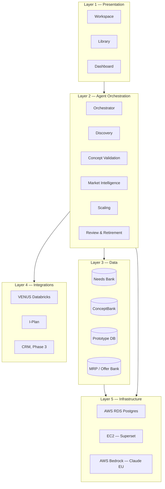
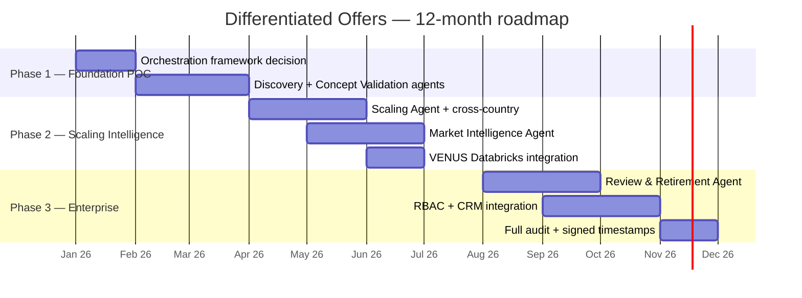

# 6. Onboarding and Kickstart (1-pager)

> **Source:** Confluence page `5800790955` in space `DODE`
> **Original URL:** <https://digitial-product-engineering.atlassian.net/wiki/spaces/DODE/pages/5800790955>
> **Diagrams:** all original PNG diagrams are inlined as Mermaid below.

---

*Single-page entry point for anyone joining the Differentiated Offers Platform build. Covers what we are building, the high-level architecture, the roadmap, Phase 1 tasks, glossary, decisions log, risks, and pointers to deeper documents.*

Start here. Then drill into the linked pages for depth.

## Table of contents

/\*<![CDATA[\*/
div.rbtoc1781584559026 {padding: 0px;}
div.rbtoc1781584559026 ul {list-style: disc;margin-left: 0px;}
div.rbtoc1781584559026 li {margin-left: 0px;padding-left: 0px;}
/\*]]>\*/

- [Table of contents](#id-6.OnboardingandKickstart(1-pager)-Tableofcontents)
- [1. How to use this set of documents](#id-6.OnboardingandKickstart(1-pager)-1.Howtousethissetofdocuments)
- [2. What we are building in one sentence](#id-6.OnboardingandKickstart(1-pager)-2.Whatwearebuildinginonesentence)
- [3. The problem](#id-6.OnboardingandKickstart(1-pager)-3.Theproblem)
- [4. What this platform is NOT](#id-6.OnboardingandKickstart(1-pager)-4.WhatthisplatformisNOT)
- [5. Solution at a glance](#id-6.OnboardingandKickstart(1-pager)-5.Solutionataglance)
  - [5.1 Three surfaces](#id-6.OnboardingandKickstart(1-pager)-5.1Threesurfaces)
  - [5.2 Six offer components, the shared taxonomy](#id-6.OnboardingandKickstart(1-pager)-5.2Sixoffercomponents,thesharedtaxonomy)
  - [5.3 Six agents](#id-6.OnboardingandKickstart(1-pager)-5.3Sixagents)
- [6. High-level architecture](#id-6.OnboardingandKickstart(1-pager)-6.High-levelarchitecture)
- [7. High-level roadmap](#id-6.OnboardingandKickstart(1-pager)-7.High-levelroadmap)
- [8. Phase 1 tasks at a glance](#id-6.OnboardingandKickstart(1-pager)-8.Phase1tasksataglance)
- [9. Phase 1 team](#id-6.OnboardingandKickstart(1-pager)-9.Phase1team)
- [10. Quick reference card](#id-6.OnboardingandKickstart(1-pager)-10.Quickreferencecard)
- [11. Decisions log](#id-6.OnboardingandKickstart(1-pager)-11.Decisionslog)
- [12. Risks register](#id-6.OnboardingandKickstart(1-pager)-12.Risksregister)
- [13. Glossary](#id-6.OnboardingandKickstart(1-pager)-13.Glossary)
- [14. Where to read more](#id-6.OnboardingandKickstart(1-pager)-14.Wheretoreadmore)

## 1. How to use this set of documents

| If you are | Read this page | Then read |
| --- | --- | --- |
| A new engineer joining the squad | This page | 8. Architecture Walkthrough, then 7. User Stories |
| A Product Owner or PM | This page + 1. Understanding & Scope | 3. Phase-wise Execution + 5. Build Plan |
| A Commercial Domain Expert | This page + 1. Understanding & Scope | The 6-component taxonomy in section 4.2 here |
| Leadership reviewing the plan | Sections 2 to 5 of this page | 3. Phase-wise Execution |
| Audit or security | Section 13 of 8. Architecture Walkthrough | 1. Understanding & Scope |

## 2. What we are building in one sentence

An AI-powered, agentic platform that guides Syngenta Europe commercial teams through the full offer development lifecycle, from initial customer need validation through to scaling proven offers across markets.

## 3. The problem

- **87 offers** are scattered across Europe with no shared development process, no shared learnings, no scaling mechanism.
- Teams routinely fall in love with solutions before validating whether genuine customer demand exists.
- The chain from customer needs to offer design to execution to value delivery is weak.
- Field evidence shows customers value **compliance, simplicity, defensibility**, not complex innovation for its own sake.

## 4. What this platform is NOT

- **Not a chatbot.** Agents act autonomously using tools and surface insights proactively.
- **Not a form wizard.** The platform makes decisions and only pauses when human judgment is genuinely required.

## 5. Solution at a glance

### 5.1 Three surfaces

| Surface | Description | Primary users |
| --- | --- | --- |
| **Workspace** | Per-offer project space, 6-stage lifecycle | Commercial teams, Agronomy |
| **Library** | Needs Bank + ConceptBank + Offer Bank, the institutional knowledge layer | All users |
| **Dashboard** | Leadership portfolio view, funnel + heatmap + white-space + scoring | Leadership, Marketing |

### 5.2 Six offer components, the shared taxonomy

| Code | Component | Examples |
| --- | --- | --- |
| **a** | Foundation | Crop Protection, Seeds, Biologicals, bundles |
| **b** | Precision Advisor | Spray Assist, NDVI, disease models, remote scouting |
| **c** | Shared Success | Subscription services, recurring digital or diagnostic per season |
| **d** | Risk Shield | Yield guarantees, weather-linked risk sharing |
| **e** | Investment Enabling | Credit, barter, loyalty rebates |
| **f** | Future Ready Farming | ESG, soil health, carbon documentation |

The most common combination is `a + b = Product Plus`.

### 5.3 Six agents

| Agent | Role | Runs | Lands in |
| --- | --- | --- | --- |
| Orchestrator | Routes events, maintains workspace state, escalates to humans | Every workspace event | Phase 1 |
| Discovery Agent | Customer need research, problem statement drafting | Stage 1 activation | Phase 1 |
| Concept Validation Agent | Differentiation scoring, duplicate detection, kill filter | On concept submission | Phase 1 |
| Market Intelligence Agent | Portfolio surveillance, pattern detection, white-space alerts | Continuously, background | Phase 2 |
| Scaling Agent | Cross-country replication briefs for live offers | On offer going Live | Phase 2 |
| Review Agent | Annual lifecycle review for MRP DB offers | Scheduled annually | Phase 3 |

## 6. High-level architecture

> **Diagram:** `do-arch-overview.png` — rewritten as Mermaid

- **Layer 1 Presentation:** Workspace + Library + Dashboard.
- **Layer 2 Agent orchestration:** Orchestrator + 5 specialist agents.
- **Layer 3 Data:** 4 AWS RDS Postgres databases (Needs Bank, ConceptBank, Prototype DB, MRP / Offer Bank).
- **Layer 4 Integrations:** VENUS Databricks, I-Plan, CRM (Phase 3).
- **Layer 5 Infrastructure:** AWS RDS, EC2 hosting Superset, AWS Bedrock with Claude under EU data residency.

For per-layer detail, API contracts, schemas, configs, and security, see the Architecture Walkthrough page.

## 7. High-level roadmap

> **Diagram:** `do-roadmap.png` — rewritten as Mermaid

| Phase | Duration | Agents live | Exit criteria |
| --- | --- | --- | --- |
| **Phase 1 Foundation POC** | ~3 months | Orchestrator, Discovery, Concept Validation | 2 pilot teams completed Stages 1 + 2 with agents, differentiation gate working, kill filter catching weak concepts, 3 baseline metrics measured |
| **Phase 2 Scaling Intelligence** | ~4 months | + Market Intelligence, + Scaling | 3 or more offers have scaling briefs, portfolio heatmap live, cross-country porting validated, 5-8 teams onboarded |
| **Phase 3 Enterprise** | ~5 months | + Review Agent, + full analytics | 60% or more EU commercial teams onboarded, annual review cycle running, % of sales from differentiated offers tracked against 5YP target |

## 8. Phase 1 tasks at a glance

| Wk | Pri | Task | Owner |
| --- | --- | --- | --- |
| 1-2 | P0 | Orchestration framework decision (LangGraph vs Step Functions) | AI Engineer |
| 1-2 | P0 | YAML configs in git (scoring, prompts, guardrails, components) | AI Engineer |
| 1-2 | P0 | Needs Bank schema + deploy | Backend |
| 2-3 | P0 | Seed Needs Bank with 70 pain points | Commercial + Backend |
| 2-4 | P0 | Offer Bank schema + deploy + seed with 87 offers | Backend |
| 3 | P0 | ConceptBank + Prototype DB schemas deployed empty | Backend |
| 3-6 | P1 | FastAPI REST layer | Backend |
| 3-5 | P1 | Discovery Agent | AI Engineer |
| 4-6 | P1 | Concept Validation Agent | AI Engineer |
| 5-7 | P1 | Orchestrator state machine | AI Engineer |
| 4-8 | P1 | Workspace UI for Stage 1 and Stage 2 | Frontend |
| 8-10 | P1 | MVP card builder UI Stage 3 basic non-agentic | Frontend |
| 4 | P1 | I-Plan data import XLSX to RDS one time | Backend |
| 9-12 | P2 | Pilot team onboarding (recommended 1 Oceanic + 1 South East) | Commercial + PM |
| 10-12 | P2 | Baseline metrics capture | PM |

## 9. Phase 1 team

| Role | FTE | Owns |
| --- | --- | --- |
| Product Owner | 1.0 | Vision, backlog, pilot feedback loops, scope trade-offs |
| AI / Agent Engineer | 1.0 | Orchestrator, Discovery, Concept Validation, LangGraph, tools, prompts |
| Fullstack Engineer | 1.0 | Workspace UI Stage 1-2, MVP card builder, orchestrator backend wiring |
| Commercial Domain Expert | 0.5 | Field bridge, seeds Needs Bank and Offer Bank, pilot onboarding |
| QA | 0.5 | E2E testing before Phase 2 |

## 10. Quick reference card

| Term | One-line meaning |
| --- | --- |
| Workspace | One offer in flight, owns its own timeline |
| Library | The 3 shared databases users can browse |
| Stage 1 | Discovery, Discovery Agent runs |
| Stage 2 | Concept Development, Concept Validation Agent runs |
| Stage 3 | MVP Building, basic form Phase 1, agentic Phase 2 |
| Stage 4 | MVP Testing, Phase 2 |
| Stage 5 | Scaling, Scaling Agent runs, Phase 2 |
| Stage 6 | Review, Review Agent runs, Phase 3 |
| Kill filter | 4 binary criteria that auto-kill weak concepts in Stage 2 |
| Differentiation gate | 5 weighted criteria producing an aggregate score |
| Borderline | Differentiation score 0.4 to 0.6, requires human review |
| Component code | One letter a-f from the 6-component taxonomy |
| Archetype | A named combination of components (e.g. "Product Plus" = a + b) |

## 11. Decisions log

Decisions that shape the platform direction. ADR records live in `docs/adr/` in the repo.

| Date | Decision | Owner | Status | ADR |
| --- | --- | --- | --- | --- |
| 2026-05-21 | 5-layer architecture model | Suryanand | Approved | (documented in Architecture Walkthrough) |
| 2026-05-21 | 6-agent design, autonomy boundaries documented | Suryanand | Approved | (documented in Architecture Walkthrough) |
| 2026-05-21 | Phase 1 covers Orchestrator + Discovery + Validation only | Suryanand + Sandor | Approved | RFC Phase 1 POC |
| 2026-05-21 | Configs (scoring, prompts, guardrails, components) live in versioned YAML | Suryanand | Approved | Pending ADR-0002 |
| 2026-05-21 | AWS Bedrock with Claude under EU data residency | Suryanand | Approved | Pending ADR-0003 |
| Open | LangGraph vs AWS Step Functions for orchestration | AI Engineer | Spike in Week 1-2 | ADR-0001 (open) |
| Open | One RDS instance with 4 schemas vs 4 instances | Backend Engineer | Default 1 instance Phase 1, revisit Phase 2 | Pending |
| Open | Workspace UI stack (React vs Next.js) | Fullstack Engineer | Default Next.js, confirm Week 2 | Pending |
| Open | Pilot team selection (Oceanic + South East recommended) | Product Owner + Commercial Expert | Decide by end of Week 4 | Pending |

## 12. Risks register

| Risk | Likelihood | Impact | Mitigation |
| --- | --- | --- | --- |
| Needs Bank seed quality is poor, agent outputs are unreliable | Medium | High | Commercial Expert sign-off on every pain point. Audit log per sign-off. Dry-run before live import. |
| LangGraph or Step Functions does not fit our usage | Low | Medium | 2-week spike comparing both before any agent code is written. |
| Pilot teams do not engage or give weak feedback | Medium | High | Select teams with documented willingness. Bi-weekly cadence. 1-page quickstart for offline use. |
| Bedrock cost overrun | Low | Medium | Pin Haiku for Phase 1. Cost alerts at 80 EUR/month. Per-agent token budgets. |
| Schema changes during Phase 1 break agent tools | Medium | Medium | Migration scripts under `db/migrations/`. Test fixtures regenerated per migration. |
| Kill filter false positives kill good concepts | Medium | Medium | Borderline escalation 0.4 to 0.6. Audit log on every kill. Bi-weekly review with Commercial Expert during Phase 1. |
| Workspace UI feels heavier than Excel | Medium | High | Internal usability test with 3 users before pilot. Autosave every 30s. Skip-friendly forms. |
| Phase 2 dependencies slip (VENUS, Dashboard) | Medium | Medium | Track in Phase 2 spike during weeks 11-12 of Phase 1. |

## 13. Glossary

| Term | Definition |
| --- | --- |
| ADR | Architecture Decision Record. One markdown file per significant decision. |
| Archetype | A named combination of components, e.g. "Product Plus" = a + b. |
| Bedrock | AWS Bedrock, the LLM hosting service. Used here for Claude Haiku. |
| BoM | Bill of materials. Not used in this product; placeholder if Phase 2 surfaces it. |
| Borderline | Differentiation score in the 0.4 to 0.6 band requiring human review. |
| ConceptBank | One of 4 databases; holds submitted concepts and validation outcomes. |
| Discovery Agent | Agent that drafts the problem statement for Stage 1. |
| Differentiation gate | The 5-criterion scoring that produces the aggregate concept score. |
| EUR/ha | Euros per hectare, the unit of customer pain value. |
| Eval set | Fixed scenarios with expected outputs used to test agent behaviour. |
| FastAPI | The Python REST framework used for the API layer. |
| Gherkin | The "GIVEN / WHEN / THEN" format for acceptance criteria. |
| I-Plan | Internal sales plan data, source for market context. |
| Kill filter | 4 binary criteria that hard-stop a concept in Stage 2. |
| LangGraph | One of the orchestration framework candidates. |
| Library | The 3 shared databases (Needs, Concept, Offer) exposed as browse views. |
| MRP DB | Master Reference Portfolio database; the Offer Bank when it goes Live. |
| Needs Bank | One of 4 databases; the authoritative customer-pain catalogue. |
| Offer Bank | One of 4 databases; catalogue of existing and live offers across Europe. |
| Orchestrator | Agent that routes events between specialist agents and surfaces briefs. |
| Prototype DB | One of 4 databases; holds MVP cards, test results, field validations. |
| RBAC | Role-based access control. Phase 3. |
| RDS | AWS Relational Database Service. Postgres engine here. |
| SCBI | Seedcare and Biologicals Institute. Adjacent to but not the focus of this product. |
| Step Functions | AWS state-machine orchestration service. Alternative to LangGraph. |
| Superset | Apache Superset, the open-source BI tool used for the Dashboard. |
| VENUS | Syngenta Databricks workspace with market size + SYT share data. |
| Workspace | One offer in flight. Owns its own timeline and agent activity. |
| YAML | The format used for versioned runtime configs. |

## 14. Where to read more

| Page | What it covers |
| --- | --- |
| [1. Understanding & Scope](https://digitial-product-engineering.atlassian.net/wiki/spaces/DODE/pages/5676762064) | Problem space, taxonomy, lifecycle methodology, success metrics |
| [2. Technical Architecture & Wiring](https://digitial-product-engineering.atlassian.net/wiki/spaces/DODE/pages/5679775984) | 5-layer model, 6-agent design with autonomy boundaries, data layer, integrations, tech stack, security |
| [3. Phase-wise Execution](https://digitial-product-engineering.atlassian.net/wiki/spaces/DODE/pages/5679776001) | Phase 1 / 2 / 3 detailed plans with deliverables, risks, dependencies |
| [4. Team Proposal](https://digitial-product-engineering.atlassian.net/wiki/spaces/DODE/pages/5677188018) | Phase 1 / 2 / 3 staffing, philosophy, governance touchpoints |
| [5. Build Plan](https://digitial-product-engineering.atlassian.net/wiki/spaces/DODE/pages/5672537182) | Sequenced tasks per phase with priorities and owners |
| [7. User Stories, Tickets and Acceptance Criteria](https://digitial-product-engineering.atlassian.net/wiki/spaces/DODE/pages/5800460607) | Detailed Phase 1 backlog with Gherkin acceptance criteria, sub-tickets, sizing |
| [8. Architecture Walkthrough](https://digitial-product-engineering.atlassian.net/wiki/spaces/DODE/pages/5800427770) | Per-layer detail, API contracts, DB schemas, YAML configs, error matrix, observability, performance, security |
| [RFC Phase 1 POC](https://digitial-product-engineering.atlassian.net/wiki/spaces/DODE/pages/5672075289) | Solution specification submitted for comments |
