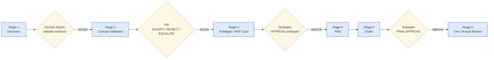
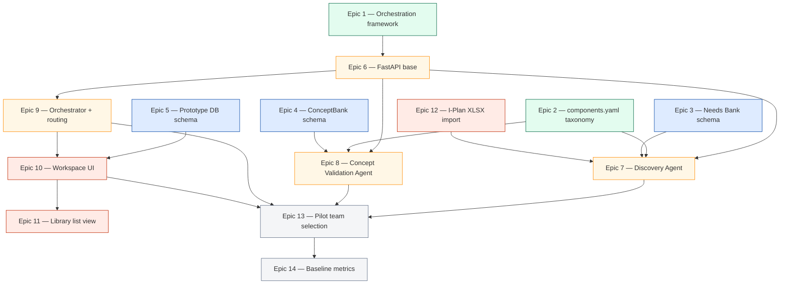
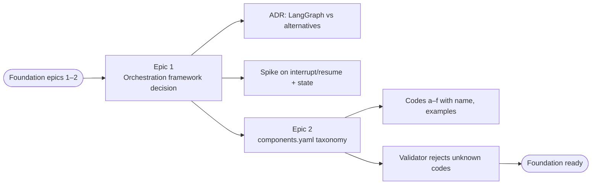
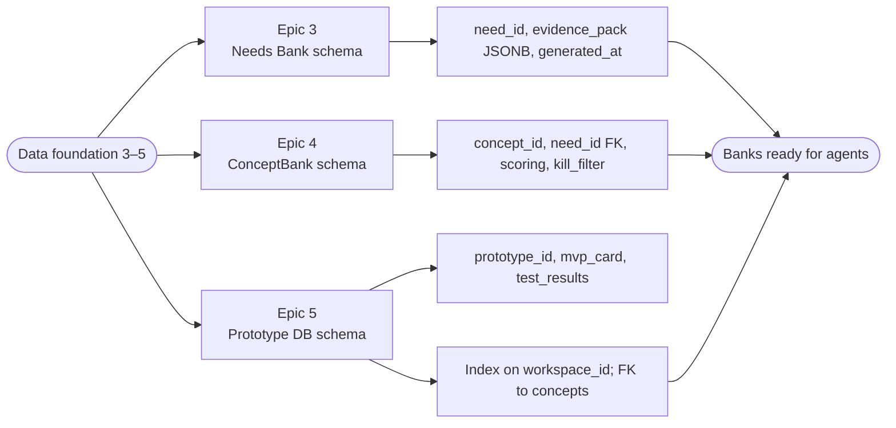
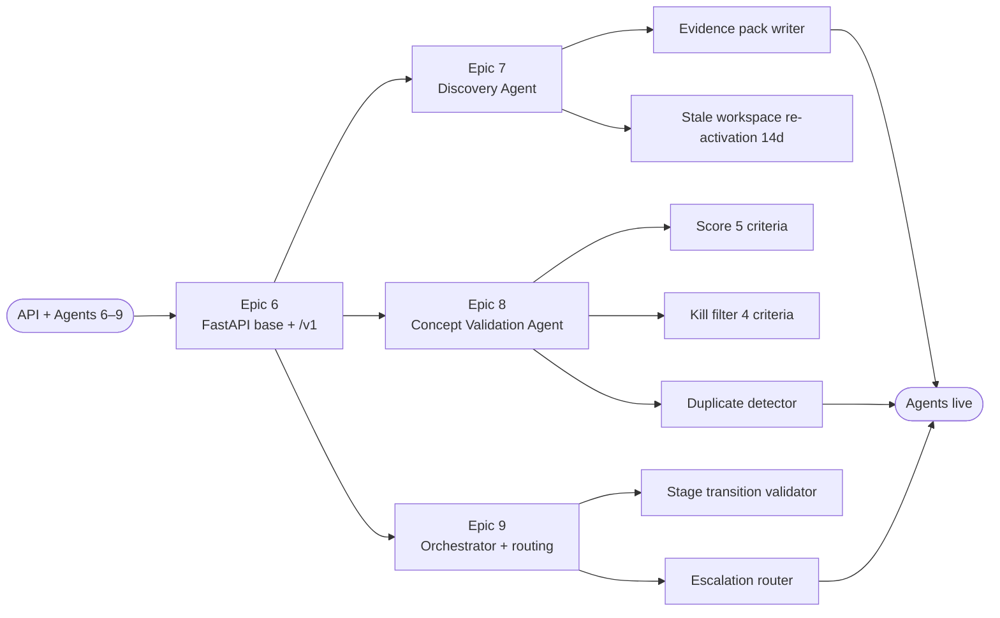
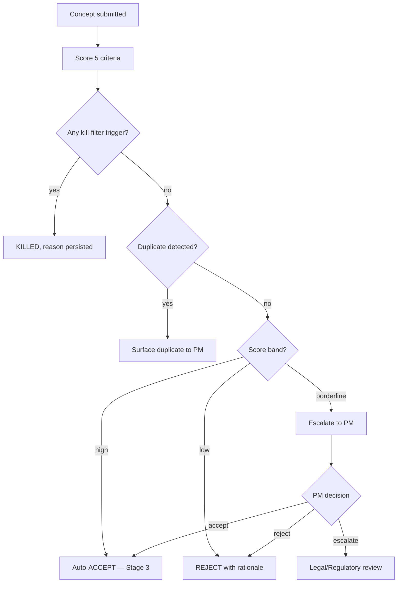
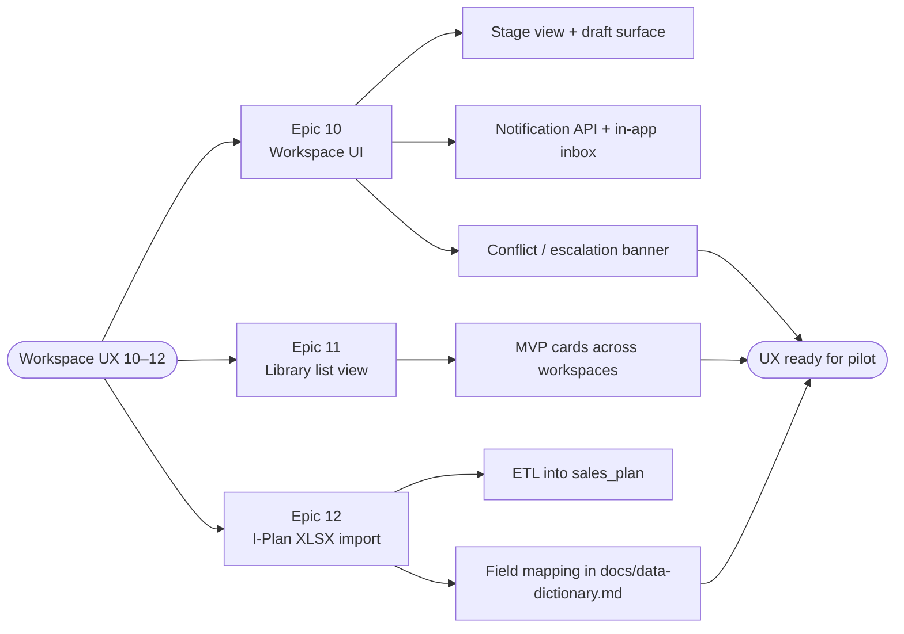
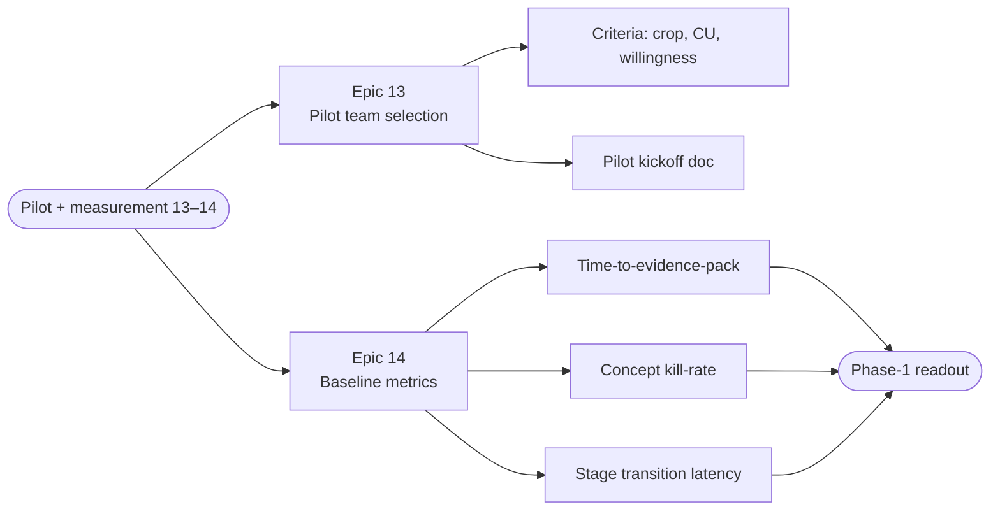

# 7. User Stories, Tickets and Acceptance Criteria

> **Source:** Confluence page `5800460607` in space `DODE`
> **Original URL:** <https://digitial-product-engineering.atlassian.net/wiki/spaces/DODE/pages/5800460607>
> **Diagrams:** all original PNG diagrams are inlined as Mermaid below.

---

*Phase 1 backlog in depth. Each epic decomposes into multiple user stories with Gherkin-style acceptance criteria, ticket and sub-ticket breakdown, sizing, dependencies, and test approach. Written so an engineer can pick up a ticket without rereading any other page.*

**How to read this page.** Section 5 is the working backlog. Sections 1 to 4 are setup. Section 6 is the Phase 1 exit gate. Sections 7 and 8 are conventions you should know before picking a ticket.

## Table of contents

/\*<![CDATA[\*/
div.rbtoc1781584559510 {padding: 0px;}
div.rbtoc1781584559510 ul {list-style: disc;margin-left: 0px;}
div.rbtoc1781584559510 li {margin-left: 0px;padding-left: 0px;}
/\*]]>\*/

- [Table of contents](#id-7.UserStories,TicketsandAcceptanceCriteria-Tableofcontents)
- [1. How this maps to the Build Plan](#id-7.UserStories,TicketsandAcceptanceCriteria-1.HowthismapstotheBuildPlan)
- [2. User personas (Phase 1 focus)](#id-7.UserStories,TicketsandAcceptanceCriteria-2.Userpersonas(Phase1focus))
- [3. User journey map](#id-7.UserStories,TicketsandAcceptanceCriteria-3.Userjourneymap)
- [4. Epic dependency graph](#id-7.UserStories,TicketsandAcceptanceCriteria-4.Epicdependencygraph)
- [5. Phase 1 epics with user stories, tickets, and acceptance criteria](#id-7.UserStories,TicketsandAcceptanceCriteria-5.Phase1epicswithuserstories,tickets,andacceptancecriteria)
  - [Foundation (Epics 1-2)](#id-7.UserStories,TicketsandAcceptanceCriteria-Foundation(Epics1-2))
  - [Epic 1 P0. Orchestration framework decision](#id-7.UserStories,TicketsandAcceptanceCriteria-Epic1P0.Orchestrationframeworkdecision)
  - [Epic 2 P0. YAML configs in git, loaded at startup](#id-7.UserStories,TicketsandAcceptanceCriteria-Epic2P0.YAMLconfigsingit,loadedatstartup)
  - [Data foundation (Epics 3-5)](#id-7.UserStories,TicketsandAcceptanceCriteria-Datafoundation(Epics3-5))
  - [Epic 3 P0. Needs Bank schema and seed](#id-7.UserStories,TicketsandAcceptanceCriteria-Epic3P0.NeedsBankschemaandseed)
  - [Epic 4 P0. Offer Bank schema and seed](#id-7.UserStories,TicketsandAcceptanceCriteria-Epic4P0.OfferBankschemaandseed)
  - [Epic 5 P0. ConceptBank and Prototype DB schemas](#id-7.UserStories,TicketsandAcceptanceCriteria-Epic5P0.ConceptBankandPrototypeDBschemas)
  - [API + Agents (Epics 6-9)](#id-7.UserStories,TicketsandAcceptanceCriteria-API+Agents(Epics6-9))
  - [Epic 6 P1. FastAPI REST layer](#id-7.UserStories,TicketsandAcceptanceCriteria-Epic6P1.FastAPIRESTlayer)
  - [Epic 7 P1. Discovery Agent](#id-7.UserStories,TicketsandAcceptanceCriteria-Epic7P1.DiscoveryAgent)
  - [Epic 8 P1. Concept Validation Agent](#id-7.UserStories,TicketsandAcceptanceCriteria-Epic8P1.ConceptValidationAgent)
  - [Epic 9 P1. Orchestrator state machine](#id-7.UserStories,TicketsandAcceptanceCriteria-Epic9P1.Orchestratorstatemachine)
  - [Workspace UX (Epics 10-12)](#id-7.UserStories,TicketsandAcceptanceCriteria-WorkspaceUX(Epics10-12))
  - [Epic 10 P1. Workspace UI Stage 1 and Stage 2](#id-7.UserStories,TicketsandAcceptanceCriteria-Epic10P1.WorkspaceUIStage1andStage2)
  - [Epic 11 P1. MVP Card Builder Stage 3 basic](#id-7.UserStories,TicketsandAcceptanceCriteria-Epic11P1.MVPCardBuilderStage3basic)
  - [Epic 12 P1. I-Plan XLSX import](#id-7.UserStories,TicketsandAcceptanceCriteria-Epic12P1.I-PlanXLSXimport)
  - [Pilot + measurement (Epics 13-14)](#id-7.UserStories,TicketsandAcceptanceCriteria-Pilot+measurement(Epics13-14))
  - [Epic 13 P2. Pilot team onboarding](#id-7.UserStories,TicketsandAcceptanceCriteria-Epic13P2.Pilotteamonboarding)
  - [Epic 14 P2. Baseline metrics capture](#id-7.UserStories,TicketsandAcceptanceCriteria-Epic14P2.Baselinemetricscapture)
- [6. Definition of Done for Phase 1 (exit gate)](#id-7.UserStories,TicketsandAcceptanceCriteria-6.DefinitionofDoneforPhase1(exitgate))
- [7. Conventions](#id-7.UserStories,TicketsandAcceptanceCriteria-7.Conventions)
  - [7.1 Story format](#id-7.UserStories,TicketsandAcceptanceCriteria-7.1Storyformat)
  - [7.2 Acceptance criteria format](#id-7.UserStories,TicketsandAcceptanceCriteria-7.2Acceptancecriteriaformat)
  - [7.3 Ticket and sub-ticket sizing](#id-7.UserStories,TicketsandAcceptanceCriteria-7.3Ticketandsub-ticketsizing)
  - [7.4 Definition of Ready (per story)](#id-7.UserStories,TicketsandAcceptanceCriteria-7.4DefinitionofReady(perstory))
  - [7.5 Definition of Done (per story)](#id-7.UserStories,TicketsandAcceptanceCriteria-7.5DefinitionofDone(perstory))
- [8. Test strategy](#id-7.UserStories,TicketsandAcceptanceCriteria-8.Teststrategy)

## 1. How this maps to the Build Plan

Phase 1 has 15 Build Plan items grouped into 14 epics. Each epic decomposes into 2 to 6 user stories. Each user story has tickets and sub-tickets with explicit acceptance criteria.

| Priority | Meaning | Gating |
| --- | --- | --- |
| P0 | Foundation. Without these, nothing else works. | Must complete before P1 work starts on the same dependency line. |
| P1 | Core build. Agents, REST layer, Workspace UI. | Must complete before P2 pilot work starts. |
| P2 | Validate with users. | Required for Phase 1 exit gate. |

## 2. User personas (Phase 1 focus)

| Persona | Goal | Where they touch the system |
| --- | --- | --- |
| Commercial team member | Build relevant offers faster, validate customer demand | Workspace UI, Stages 1 to 3 |
| Commercial Domain Expert | Validate agent outputs against real field judgment, seed and QA the banks | Workspace + Library, seeding scripts |
| Product Owner | Run pilot feedback loops, set priorities, measure baseline metrics | Workspace, Build Plan tooling, basic dashboard |
| AI / Agent Engineer | Ship agents that hit autonomy boundaries correctly | Agent code, configs, REST layer |
| Fullstack Engineer | Ship UI that feels lighter than Excel, not heavier | Workspace UI, MVP card builder |
| QA Engineer | E2E coverage before Phase 2 | Test fixtures, integration tests, pilot user observation |

## 3. User journey map

> **Diagram:** `do-user-journey.png` — rewritten as Mermaid

## 4. Epic dependency graph

> **Diagram:** `do-epic-dependencies.png` — rewritten as Mermaid

## 5. Phase 1 epics with user stories, tickets, and acceptance criteria

### Foundation (Epics 1-2)

> **Diagram:** `do-grp1-flow.png` — rewritten as Mermaid

*Group 1: Foundation - orchestration framework decision plus YAML configs.*

### Epic 1 P0. Orchestration framework decision

**Goal:** Pick between LangGraph and AWS Step Functions before any agent code is written.

**Owner:** AI / Agent Engineer. **Duration:** Week 1-2. **Size estimate:** 5 story points.

#### Story 1.1 - Build a LangGraph routing prototype

- **Story:** As an AI Engineer, I want a 1-day LangGraph throwaway prototype routing between two stub agents, so that I can evaluate the developer experience.
- **Priority:** P0. **Size:** 2 points.
- **Tickets:**
  - 1.1.1 Set up LangGraph project skeleton with two stub agents (echo agent and timestamp agent) and a router.
    - 1.1.1.a `pyproject.toml` with pinned LangGraph version.
    - 1.1.1.b Stub agents return canned responses.
    - 1.1.1.c Router decides agent by a single env flag.
  - 1.1.2 Run the prototype against a sample Discovery payload.
    - 1.1.2.a Sample payload committed under `tests/fixtures/discovery_payload.json`.
    - 1.1.2.b Recorded latency in milliseconds.
    - 1.1.2.c Bedrock invocation skipped (use a fake response).
  - 1.1.3 Capture findings in the ADR template.
    - 1.1.3.a DX rating, latency observation, Bedrock integration ergonomics.
- **Acceptance criteria:**

  | Given | When | Then |
  | --- | --- | --- |
  | the LangGraph prototype repository | I run `python -m do_orch.demo` | it returns a routed response within 100 ms (Bedrock mocked) |
  | the recorded findings | the squad reviews them | the ADR draft includes DX rating, latency, and Bedrock integration notes |
- **Dependencies:** none.
- **Test approach:** unit test the router decision. Integration test with mocked Bedrock client.

#### Story 1.2 - Build a Step Functions routing prototype

- **Story:** As an AI Engineer, I want the same prototype in AWS Step Functions, so that we can compare like-for-like.
- **Priority:** P0. **Size:** 2 points.
- **Tickets:**
  - 1.2.1 CDK or Terraform stack with two Lambdas (Discovery stub + Validation stub) + state machine.
  - 1.2.2 Replay the same Discovery payload.
  - 1.2.3 Capture findings into the same ADR.
- **Acceptance criteria:**

  | Given | When | Then |
  | --- | --- | --- |
  | the Step Functions stack | the state machine is invoked with the sample payload | it completes within 5 seconds and writes the result to a dev S3 bucket |
  | the recorded findings | the squad reviews them | the ADR includes operational cost estimate and cold-start latency |
- **Dependencies:** AWS dev account access.
- **Test approach:** integration test using LocalStack or a dev account.

#### Story 1.3 - Decision ADR signed off

- **Story:** As Tech Lead, I want a signed-off ADR with a clear recommendation, so that downstream agent code targets one framework.
- **Priority:** P0. **Size:** 1 point.
- **Tickets:**
  - 1.3.1 Side-by-side comparison table (DX, latency, cost, Bedrock ergonomics, observability, team familiarity).
  - 1.3.2 Squad review meeting.
  - 1.3.3 ADR `0001-orchestration-framework.md` committed under `docs/adr/`.
- **Acceptance criteria:**

  | Given | When | Then |
  | --- | --- | --- |
  | both prototypes are evaluated | the squad meets | a single framework is chosen with at least 3 squad members signing off in the ADR |
  | the ADR is merged | any downstream story starts | it references the ADR id in its design notes |
- **Dependencies:** Stories 1.1 and 1.2.

### Epic 2 P0. YAML configs in git, loaded at startup

**Goal:** Runtime configs are versioned, auditable, and changeable without code deploys.

**Owner:** AI / Agent Engineer + Commercial Domain Expert (review). **Duration:** Week 1-2. **Size:** 8 points.

#### Story 2.1 - `scoring.yaml` with 5 differentiation + 4 kill-filter criteria

- **Story:** As a Concept Validation Agent, I want my scoring rules in YAML, so that the Commercial Domain Expert can adjust weights without code changes.
- **Priority:** P0. **Size:** 3 points.
- **Tickets:**
  - 2.1.1 Define 5 differentiation criteria: customer\_value, defensibility, simplicity, compliance, scaling\_potential. Each with weight and scale 0 to 1.
  - 2.1.2 Define 4 kill-filter criteria: no\_validated\_need, not\_regulatory\_feasible, no\_commercial\_fit, no\_internal\_capability. Each binary.
  - 2.1.3 JSON Schema for `scoring.yaml`.
  - 2.1.4 Reload mechanism on agent startup with hot reload disabled in prod.
- **Acceptance criteria:**

  | Given | When | Then |
  | --- | --- | --- |
  | `scoring.yaml` with valid weights | the agent starts | it loads without error and exposes a `/health/config` endpoint reporting the active config hash |
  | `scoring.yaml` with an invalid weight (sum not equal to 1.0) | the agent starts | startup fails with a clear validation error pointing at the offending line |
  | a pull request changing a weight | it is opened | at least one Commercial Domain Expert is required as reviewer (CODEOWNERS) |
- **Test approach:** JSON Schema validation test, startup integration test, CODEOWNERS rule test.

#### Story 2.2 - `prompts.yaml` with per-agent system prompts

- **Story:** As an AI Engineer, I want prompts in versioned YAML so that prompt changes are auditable and rollback is trivial.
- **Priority:** P0. **Size:** 2 points.
- **Tickets:**
  - 2.2.1 Schema: per-agent block with system\_prompt, model\_id, temperature, max\_tokens, output\_schema (json schema).
  - 2.2.2 Discovery Agent prompt v0.
  - 2.2.3 Concept Validation Agent prompt v0.
- **Acceptance criteria:**

  | Given | When | Then |
  | --- | --- | --- |
  | `prompts.yaml` | the agent is invoked | it uses the system prompt matching its agent id |
  | a prompt change is merged | the next agent invocation runs | the new prompt is active and the previous hash is logged |

#### Story 2.3 - `guardrails.yaml` with refusal and escalation rules

- **Story:** As a Concept Validation Agent, I want explicit refusal and escalation rules so that legal or regulatory questions trigger human review.
- **Priority:** P0. **Size:** 2 points.
- **Tickets:**
  - 2.3.1 Refusal rules (e.g. concept claims regulatory approval that the system cannot verify).
  - 2.3.2 Escalation rules with target roles (legal, regional lead).
  - 2.3.3 Test fixtures for each guardrail.
- **Acceptance criteria:**

  | Given | When | Then |
  | --- | --- | --- |
  | a concept triggering a refusal rule | it enters Stage 2 | the agent refuses with the rule id cited |
  | a concept triggering an escalation rule | the orchestrator routes it | a notification is created for the named target role |

#### Story 2.4 - `components.yaml` taxonomy

- **Story:** As a Discovery Agent and a Concept Validation Agent, I want the 6-component taxonomy in YAML so that all agents speak the same language.
- **Priority:** P0. **Size:** 1 point.
- **Tickets:**
  - 2.4.1 Component codes a-f with name, description, examples.
  - 2.4.2 Validator that rejects unknown component codes in any payload.
- **Acceptance criteria:**

  | Given | When | Then |
  | --- | --- | --- |
  | `components.yaml` | any agent reads a component code | it can resolve the human-readable name and description |
  | a payload with code `z` | validation runs | the payload is rejected with "unknown component code" |

### Data foundation (Epics 3-5)

> **Diagram:** `do-grp2-flow.png` — rewritten as Mermaid

*Group 2: Data foundation - Needs Bank, Offer Bank, and the schemas concepts will write to.*

### Epic 3 P0. Needs Bank schema and seed

**Goal:** 70 validated pain points queryable from agents within Week 3.

**Owner:** Backend Engineer + Commercial Domain Expert. **Duration:** Week 1-3. **Size:** 13 points.

#### Story 3.1 - Needs Bank schema

- **Story:** As a Discovery Agent, I want a Needs Bank schema so that pain points are queryable by crop, country, category, and value.
- **Priority:** P0. **Size:** 3 points.
- **Tickets:**
  - 3.1.1 Columns: `pain_id` (uuid pk), `crop` (text), `country` (iso2), `category` (enum a-f), `pain_value_eur_per_ha` (numeric), `description` (text), `source` (text), `validated_at` (timestamptz), `validator` (text), `active` (bool).
  - 3.1.2 Indexes on (crop, country) and on category.
  - 3.1.3 Migration script in `db/migrations/0001_needs_bank.sql`.
  - 3.1.4 Deploy to RDS dev.
- **Acceptance criteria:**

  | Given | When | Then |
  | --- | --- | --- |
  | the migration is applied | psql connects to dev | the table exists with all columns and indexes |
  | a SELECT by crop=corn and country=FR | the query is timed | p95 latency is under 100 ms with 1000 rows |

#### Story 3.2 - ETL from XLSX

- **Story:** As a Product Owner, I want the 70 pain points from `Europe customer needs bank.xlsx` loaded so the Discovery Agent has real data.
- **Priority:** P0. **Size:** 3 points.
- **Tickets:**
  - 3.2.1 Read XLSX rows A1 to G5 (or the documented seed range).
  - 3.2.2 Map columns to schema fields.
  - 3.2.3 Idempotent upsert on `(crop, country, category, description)` natural key.
  - 3.2.4 Dry-run mode that prints inserts without writing.
- **Acceptance criteria:**

  | Given | When | Then |
  | --- | --- | --- |
  | the XLSX file at `seed/europe_customer_needs_bank.xlsx` | `python -m do_seed.needs_bank` runs in dry-run | it prints 70 inserts and no DB writes happen |
  | dry-run output is approved | the live run executes | exactly 70 rows are inserted and re-running is a no-op |

#### Story 3.3 - Commercial Expert sign-off workflow

- **Story:** As a Commercial Domain Expert, I want a sign-off workflow so my approvals are recorded with timestamp.
- **Priority:** P0. **Size:** 2 points.
- **Tickets:**
  - 3.3.1 Sign-off CLI: `do-cli needs sign-off --pain-id ... --validator ...`.
  - 3.3.2 Bulk sign-off from a list of pain ids.
  - 3.3.3 Audit log entry per sign-off.
- **Acceptance criteria:**

  | Given | When | Then |
  | --- | --- | --- |
  | a Commercial Expert signs off pain id X | audit log is queried | there is exactly one entry with the validator name and timestamp |

#### Story 3.4 - Needs Bank query tool for the Discovery Agent

- **Story:** As a Discovery Agent, I want a typed tool to query the Needs Bank.
- **Priority:** P0. **Size:** 3 points.
- **Tickets:**
  - 3.4.1 Tool signature `query_needs_bank(crop: str, country: str, category: list[str], limit: int = 3)`.
  - 3.4.2 Ranking by `pain_value_eur_per_ha` desc.
  - 3.4.3 Returns evidence pack with source and validator.
- **Acceptance criteria:**

  | Given | When | Then |
  | --- | --- | --- |
  | crop=corn and country=FR | the tool is called | it returns top 3 pain points sorted by euro/ha desc with their source |

#### Story 3.5 - Schema and seed documentation

- **Story:** As a new engineer, I want the schema documented so I do not have to read the migration to understand the data.
- **Priority:** P0. **Size:** 2 points.
- **Acceptance criteria:**

  | Given | When | Then |
  | --- | --- | --- |
  | the architecture walkthrough page | I open it | it shows the Needs Bank columns, types, indexes, and example rows |

### Epic 4 P0. Offer Bank schema and seed

**Goal:** 87 offers + 39 scored entries loaded with duplicate detection. **Owner:** Backend Engineer. **Duration:** Week 2-4. **Size:** 13 points.

#### Story 4.1 - Offer Bank schema

- **Story:** As a Discovery Agent and a Concept Validation Agent, I want an Offer Bank schema covering archetype, region, components, score, and lifecycle.
- **Size:** 3 points.
- **Tickets:**
  - 4.1.1 Columns: `offer_id`, `name`, `archetype_code`, `region`, `country` (nullable), `component_codes` (array of enum a-f), `score` (numeric nullable), `status`, `lifecycle_state` (enum), `created_at`, `updated_at`.
  - 4.1.2 Indexes on (archetype\_code, region), on lifecycle\_state, GIN on component\_codes.
  - 4.1.3 Unique partial index on (archetype\_code, region, component\_codes\_hash) where active.
- **Acceptance criteria:**

  | Given | When | Then |
  | --- | --- | --- |
  | the migration is applied | I attempt to insert two offers with identical (archetype, region, components) | the second insert fails |

#### Story 4.2 - ETL for the 87 offers and 39 scored entries

- **Story:** As a Product Owner, I want existing offers loaded so the Discovery Agent has the offer landscape to query.
- **Size:** 4 points.
- **Tickets:**
  - 4.2.1 Read `Current Offers & Quick Wins.xlsx` for the 87 offers.
  - 4.2.2 Read the Offer Bank sheet for the 39 scored entries (join by offer name).
  - 4.2.3 Idempotent upsert on natural key.
  - 4.2.4 Validation that all archetype codes resolve in `components.yaml`.
- **Acceptance criteria:**

  | Given | When | Then |
  | --- | --- | --- |
  | the seed XLSX files | seeding runs | 87 offers exist and 39 of them carry a non-null score |
  | an unknown archetype in the seed | seeding runs | it fails fast with the offending row reference |

#### Story 4.3 - Offer Bank search tool for Discovery Agent

- **Story:** As a Discovery Agent, I want a tool that returns existing offers in the same archetype and region.
- **Size:** 3 points.
- **Tickets:**
  - 4.3.1 Tool signature `search_offer_bank(archetype: str, region: str, components: list[str] = None, limit: int = 10)`.
  - 4.3.2 Returns offers ranked by score desc, with nulls last.

#### Story 4.4 - Duplicate detection helper for Concept Validation Agent

- **Story:** As a Concept Validation Agent, I want a similarity score against all live offers so I can flag duplicates.
- **Size:** 3 points.
- **Tickets:**
  - 4.4.1 Define similarity: weighted Jaccard on components + exact match on (archetype, region).
  - 4.4.2 Function returns top 3 similar offers with similarity in [0, 1].
- **Acceptance criteria:**

  | Given | When | Then |
  | --- | --- | --- |
  | a concept with (archetype=Product Plus, region=Oceanic, components=[a, b]) | duplicate detection runs against an Offer Bank containing the exact same combination | the similarity score for that offer is 1.0 |

### Epic 5 P0. ConceptBank and Prototype DB schemas

**Goal:** Schemas deployed empty so Phase 1 agents can write to them. **Owner:** Backend Engineer. **Duration:** Week 3. **Size:** 5 points.

#### Story 5.1 - ConceptBank schema

- **Story:** As a Concept Validation Agent, I want to write validation outcomes to a structured store.
- **Size:** 3 points.
- **Tickets:**
  - 5.1.1 Columns: `concept_id`, `workspace_id` (fk), `problem_statement_ref`, `differentiation_score` (jsonb with 5 sub-scores), `kill_filter_result` (jsonb), `duplicate_score` (numeric), `top_duplicates` (jsonb), `guardrail_flags` (jsonb), `decision` (enum: pass, kill, borderline, escalate), `decided_at`, `decided_by`.
  - 5.1.2 FK to `workspaces`.
  - 5.1.3 Index on workspace\_id.
- **Acceptance criteria:**

  | Given | When | Then |
  | --- | --- | --- |
  | a concept submission | the validation agent finishes | exactly one row is inserted with the full result payload |

#### Story 5.2 - Prototype DB schema

- **Story:** As a Workspace UI, I want to persist MVP cards for Stage 3.
- **Size:** 2 points.
- **Tickets:**
  - 5.2.1 Columns: `prototype_id`, `concept_id` (fk), `mvp_card` (jsonb: target persona, value prop, components, early adopter profile, test plan, success metric), `test_results` (jsonb), `field_validations` (jsonb), `created_at`, `updated_at`.
  - 5.2.2 FK to `concepts`.

### API + Agents (Epics 6-9)

> **Diagram:** `do-grp3-flow.png` — rewritten as Mermaid

*Group 3: API plus agents - REST layer, Discovery and Concept Validation agents, Orchestrator.*

### Epic 6 P1. FastAPI REST layer

**Goal:** Workspace UI talks to agents through a versioned REST API. **Owner:** Backend Engineer. **Duration:** Week 3-6. **Size:** 13 points.

#### Story 6.1 - Project scaffolding + auth placeholder

- **Story:** As an engineer, I want a working FastAPI project with auth stub and config loader.
- **Size:** 3 points.
- **Tickets:**
  - 6.1.1 Project structure with `api/`, `schemas/`, `services/`, `tests/`.
  - 6.1.2 Auth: bearer token from header validated against an env-configured static token for Phase 1.
  - 6.1.3 Settings loaded from env + `.env.local`.
  - 6.1.4 `/healthz` and `/readyz` endpoints.
- **Acceptance criteria:**

  | Given | When | Then |
  | --- | --- | --- |
  | the FastAPI project | `uvicorn api.main:app` runs locally | `/healthz` returns 200 and `/docs` serves OpenAPI |
  | a request without bearer token | any non-health endpoint is hit | the response is 401 |

#### Story 6.2 - Workspace endpoints

- **Story:** As Workspace UI, I want workspace CRUD endpoints.
- **Size:** 3 points.
- **Tickets:**
  - 6.2.1 `POST /v1/workspace` with body `{name, owner_role, archetype, region, country}`.
  - 6.2.2 `GET /v1/workspace/{id}`.
  - 6.2.3 `PATCH /v1/workspace/{id}/stage` with state transition validation.
  - 6.2.4 `GET /v1/workspace/{id}/timeline`.
- **Acceptance criteria:**

  | Given | When | Then |
  | --- | --- | --- |
  | a POST with valid body | the endpoint runs | a row is created and the response includes `workspace_id` and initial stage Stage 1 |
  | a PATCH to an invalid stage | it runs | the response is 422 with "invalid stage transition" |

#### Story 6.3 - Library read endpoints

- **Story:** As Workspace UI, I want to list pain points and existing offers.
- **Size:** 2 points.
- **Tickets:**
  - 6.3.1 `GET /v1/needs-bank` with filter query params crop, country, category.
  - 6.3.2 `GET /v1/offer-bank` with filter query params archetype, region.
  - 6.3.3 Pagination via cursor.

#### Story 6.4 - Concept submission endpoint

- **Story:** As Workspace UI, I want to submit a concept for validation.
- **Size:** 3 points.
- **Tickets:**
  - 6.4.1 `POST /v1/concept` with body `{workspace_id, problem_statement, archetype, region, components}`.
  - 6.4.2 Endpoint dispatches an event to the Orchestrator.
  - 6.4.3 `GET /v1/concept/{id}` returns latest validation result.
- **Acceptance criteria:**

  | Given | When | Then |
  | --- | --- | --- |
  | a valid concept submission | the endpoint runs | it returns 202 Accepted with a concept\_id within 200 ms |
  | the concept\_id | GET is polled | within 30 seconds it returns a validation result with decision in (pass, kill, borderline, escalate) |

#### Story 6.5 - OpenAPI and dev environment

- **Story:** As a Frontend Engineer, I want the OpenAPI spec served + a local dev environment.
- **Size:** 2 points.
- **Tickets:**
  - 6.5.1 `/docs` serves Swagger UI.
  - 6.5.2 `docker-compose.yml` with Postgres + FastAPI + a mock agent runner.
  - 6.5.3 Smoke test script that walks the full happy path.

### Epic 7 P1. Discovery Agent

**Goal:** Stage 1 evidence pack and problem statement drafted autonomously. **Owner:** AI Engineer. **Duration:** Week 3-5. **Size:** 13 points.

#### Story 7.1 - Needs Bank query tool wrapper

- **Story:** As a Discovery Agent, I want a typed wrapper around the Needs Bank query so my prompts can call it deterministically.
- **Size:** 2 points.
- **Tickets:**
  - 7.1.1 Typed function signature.
  - 7.1.2 Bedrock-compatible tool spec (for tool use).
  - 7.1.3 Error mapping (DB errors to graceful agent responses).

#### Story 7.2 - Offer Bank search tool wrapper

- **Story:** As a Discovery Agent, I want a typed wrapper around the Offer Bank search.
- **Size:** 2 points.

#### Story 7.3 - Problem statement drafter

- **Story:** As a Commercial team member, I want the Discovery Agent to draft a problem statement from the top pain points so I do not start with a blank page.
- **Size:** 4 points.
- **Tickets:**
  - 7.3.1 System prompt in `prompts.yaml` referencing the evidence pack format.
  - 7.3.2 Output schema enforced via Bedrock tool use or post-call validation.
  - 7.3.3 Eval set of 10 known crop+country combinations with expected pain points cited.
- **Acceptance criteria:**

  | Given | When | Then |
  | --- | --- | --- |
  | crop=corn and country=FR | the Discovery Agent runs | the problem statement cites at least 2 pain points by id and includes a numeric euro/ha figure |
  | the eval set | it runs in CI | at least 8 of 10 cases pass the cited-pain-point assertion |

#### Story 7.4 - Evidence pack assembly and persistence

- **Story:** As a Workspace UI, I want the evidence pack persisted to ConceptBank stub so I can render it without calling Bedrock again.
- **Size:** 3 points.

#### Story 7.5 - Re-activation logic on stale workspace

- **Story:** As an Orchestrator, I want the Discovery Agent to re-run if a workspace has been idle for more than 14 days so the evidence pack stays current.
- **Size:** 2 points.
- **Acceptance criteria:**

  | Given | When | Then |
  | --- | --- | --- |
  | a workspace with no activity for 15 days | the scheduler fires | the Discovery Agent re-runs and writes a new evidence pack with a new `generated_at` |

### Epic 8 P1. Concept Validation Agent

**Goal:** Stage 2 auto-scored. Weak concepts killed. Duplicates surfaced. **Owner:** AI Engineer. **Duration:** Week 4-6. **Size:** 13 points.

> **Diagram:** `do-validation-decision.png` — rewritten as Mermaid

#### Story 8.1 - Differentiation scorer

- **Story:** As a Commercial team member, I want a differentiation score per concept so I know how strong it is before investing more time.
- **Size:** 4 points.
- **Tickets:**
  - 8.1.1 5 sub-scorers driven by `scoring.yaml` weights.
  - 8.1.2 Each sub-scorer prompt returns a score in [0,1] with a justification string.
  - 8.1.3 Aggregate score = weighted sum.
  - 8.1.4 Persist per-sub-score + aggregate to ConceptBank.
- **Acceptance criteria:**

  | Given | When | Then |
  | --- | --- | --- |
  | a concept | scoring runs | 5 sub-scores + 1 aggregate land in ConceptBank with justifications |
  | a weighting change in `scoring.yaml` | the next scoring runs | the aggregate reflects the new weights |

#### Story 8.2 - Kill filter

- **Story:** As a Commercial team member, I want bad concepts killed early so we do not waste cycles.
- **Size:** 3 points.
- **Tickets:**
  - 8.2.1 4 binary checks defined by `scoring.yaml`.
  - 8.2.2 Any failed check sets decision=kill with the criterion id and reason logged.
- **Acceptance criteria:**

  | Given | When | Then |
  | --- | --- | --- |
  | a concept with no validated need | the kill filter runs | the decision is kill with criterion id `no_validated_need` and the reason cites the missing Needs Bank evidence |

#### Story 8.3 - Duplicate detector

- **Story:** As a Commercial team member, I want the duplicate detector to surface very similar live offers so I can pivot or merge.
- **Size:** 3 points.
- **Acceptance criteria:**

  | Given | When | Then |
  | --- | --- | --- |
  | a concept matching an existing offer at similarity 1.0 | duplicate detection runs | the decision routes to escalate with top duplicates surfaced in the workspace |

#### Story 8.4 - Guardrails checker

- **Story:** As a Concept Validation Agent, I want guardrails enforced so regulated topics escalate to legal.
- **Size:** 2 points.

#### Story 8.5 - Borderline escalation

- **Story:** As an Orchestrator, I want borderline scores to escalate to a named human reviewer.
- **Size:** 1 point.

### Epic 9 P1. Orchestrator state machine

**Goal:** Workspace events routed deterministically. **Owner:** AI Engineer. **Duration:** Week 5-7. **Size:** 13 points.

#### Story 9.1 - State machine model

- **Story:** As an AI Engineer, I want the workspace state machine modelled in code with explicit transitions.
- **Size:** 4 points.
- **Tickets:**
  - 9.1.1 States: stage\_1\_active, stage\_1\_complete, stage\_2\_active, stage\_2\_complete, stage\_3\_active, killed, escalated.
  - 9.1.2 Allowed transitions documented in code.
  - 9.1.3 Transition validator with explicit refusal messages.

#### Story 9.2 - Agent spawner

- **Story:** As an Orchestrator, I want to activate the right agent per event.
- **Size:** 3 points.

#### Story 9.3 - Human escalation triggers

- **Story:** As an Orchestrator, I want explicit human escalation triggers so humans only step in when needed.
- **Size:** 3 points.
- **Acceptance criteria:**

  | Given | When | Then |
  | --- | --- | --- |
  | borderline differentiation score (0.4 to 0.6) | routing decides | an escalation notification is created |
  | two agents return conflicting recommendations | routing decides | the workspace state becomes escalated with both outputs surfaced |

#### Story 9.4 - Notification dispatcher

- **Story:** As an escalation target, I want a notification when my review is required.
- **Size:** 2 points.
- **Tickets:**
  - 9.4.1 In-app notification table.
  - 9.4.2 Notification API to mark read / acknowledged.
  - 9.4.3 Email channel deferred to Phase 2.

#### Story 9.5 - Stage transition validator

- **Story:** As a workspace, I want stage transitions refused if criteria are not met.
- **Size:** 1 point.

### Workspace UX (Epics 10-12)

> **Diagram:** `do-grp4-flow.png` — rewritten as Mermaid

*Group 4: Workspace UX - Stage 1-2 surfaces, MVP card builder, I-Plan import feeding Discovery.*

### Epic 10 P1. Workspace UI Stage 1 and Stage 2

**Goal:** Lighter than Excel. Commercial team can self-serve through Stage 1 + 2. **Owner:** Fullstack Engineer. **Duration:** Week 4-8. **Size:** 21 points.

#### Story 10.1 - Workspace creation flow

- **Story:** As a Commercial team member, I want to create a workspace in 3 fields.
- **Size:** 3 points.
- **Tickets:**
  - 10.1.1 Form: name, archetype, region. Country optional.
  - 10.1.2 Server side: POST /v1/workspace.
  - 10.1.3 Redirect to Stage 1 view.

#### Story 10.2 - Stage 1 Discovery view

- **Story:** As a Commercial team member, I want the Discovery Agent evidence pack visible inline with an editable problem statement.
- **Size:** 6 points.
- **Tickets:**
  - 10.2.1 Evidence pack cards (top 3 pain points with euro/ha).
  - 10.2.2 Existing offers panel.
  - 10.2.3 Editable problem statement textarea with autosave every 30 seconds.
  - 10.2.4 Submit button progresses to Stage 2.
- **Acceptance criteria:**

  | Given | When | Then |
  | --- | --- | --- |
  | a new workspace | I open Stage 1 | the evidence pack appears within 5 seconds |
  | I edit the problem statement | 30 seconds pass without interaction | it autosaves and a "saved" indicator appears |

#### Story 10.3 - Stage 2 Concept Development view

- **Story:** As a Commercial team member, I want to see differentiation score breakdown, kill filter reasons, and duplicate matches with diff so I can decide pivot, accept, or discard.
- **Size:** 6 points.
- **Tickets:**
  - 10.3.1 Score panel: aggregate + 5 sub-scores + justification per sub-score.
  - 10.3.2 Kill filter panel: each criterion with pass / fail and reason.
  - 10.3.3 Duplicate panel: top 3 similar offers with similarity score and component diff.
  - 10.3.4 Action bar: pivot, accept, discard.

#### Story 10.4 - Workspace timeline

- **Story:** As an auditor, I want every agent action and human decision visible in the workspace.
- **Size:** 3 points.

#### Story 10.5 - Drafts and autosave

- **Story:** As a Commercial team member, I want my work autosaved.
- **Size:** 3 points.

### Epic 11 P1. MVP Card Builder Stage 3 basic

**Goal:** Capture MVP cards even before Stage 3 has an agentic layer. **Owner:** Fullstack Engineer. **Duration:** Week 8-10. **Size:** 8 points.

#### Story 11.1 - MVP card schema

- **Story:** As a Commercial team member, I want a structured MVP card so my notes are reusable.
- **Size:** 2 points.
- **Tickets:**
  - 11.1.1 Fields: target persona, value proposition, ingredients (codes a-f), early adopter profile, test plan, success metric.

#### Story 11.2 - Stage 3 form UI

- **Story:** As a Commercial team member, I want to fill the MVP card in the workspace.
- **Size:** 4 points.

#### Story 11.3 - Library list view of submitted cards

- **Story:** As a Product Owner, I want to see all MVP cards across workspaces.
- **Size:** 2 points.

### Epic 12 P1. I-Plan XLSX import

**Goal:** Sales plan available to the Discovery Agent without live integration. **Owner:** Backend Engineer. **Duration:** Week 4. **Size:** 3 points.

#### Story 12.1 - XLSX reader and mapping

- **Story:** As a Discovery Agent, I want I-Plan rows queryable.
- **Size:** 3 points.
- **Tickets:**
  - 12.1.1 ETL script reading I-Plan XLSX into a `sales_plan` table.
  - 12.1.2 Field mapping documented under `docs/data-dictionary.md`.
  - 12.1.3 Idempotent run.

### Pilot + measurement (Epics 13-14)

> **Diagram:** `do-grp5-flow.png` — rewritten as Mermaid

*Group 5: Pilot plus measurement - team onboarding, feedback rhythm, three baseline metrics.*

### Epic 13 P2. Pilot team onboarding

**Goal:** 2 teams using the platform on real offers. **Owner:** Product Owner + Commercial Expert. **Duration:** Week 9-12. **Size:** 8 points.

#### Story 13.1 - Select 2 pilot teams

- **Story:** As a Product Owner, I want criteria for pilot team selection so the picks are defensible.
- **Size:** 1 point.
- **Tickets:**
  - 13.1.1 Selection rubric: 1 Oceanic + 1 South East, mix of archetype maturity, willingness to give feedback.
  - 13.1.2 Sign-off from Commercial Lead per team.

#### Story 13.2 - Onboarding session

- **Story:** As a pilot team member, I want a 1-hour session covering the lifecycle and Workspace UI.
- **Size:** 3 points.
- **Tickets:**
  - 13.2.1 Slide deck + demo workspace.
  - 13.2.2 1-pager quickstart for offline reference.
  - 13.2.3 Schedule per team.

#### Story 13.3 - Feedback cadence setup

- **Story:** As a Product Owner, I want a bi-weekly feedback rhythm so issues land in the backlog.
- **Size:** 2 points.

#### Story 13.4 - Issue triage protocol

- **Story:** As an engineer, I want a triage protocol for pilot issues.
- **Size:** 2 points.
- **Acceptance criteria:**

  | Given | When | Then |
  | --- | --- | --- |
  | a pilot issue is logged | 48 hours pass | the issue has a priority and an owner |

### Epic 14 P2. Baseline metrics capture

**Goal:** Phase 1 exit gate decision is data-driven. **Owner:** Product Owner. **Duration:** Week 10-12. **Size:** 5 points.

#### Story 14.1 - Metric definitions

- **Story:** As a Product Owner, I want 3 baseline metrics defined with formulas.
- **Size:** 2 points.
- **Tickets:**
  - 14.1.1 Metric 1 time\_to\_problem\_statement = (problem\_statement.created\_at - workspace.created\_at) in minutes.
  - 14.1.2 Metric 2 kill\_filter\_hit\_rate = killed\_concepts / total\_concepts in [0,1].
  - 14.1.3 Metric 3 differentiation\_gate\_pass\_rate = passed / (passed + killed + escalated).

#### Story 14.2 - Instrumentation

- **Story:** As an engineer, I want every workspace event timestamped so metrics are computable.
- **Size:** 2 points.

#### Story 14.3 - Basic query view

- **Story:** As a Product Owner, I want a basic page showing the 3 metric values.
- **Size:** 1 point.

## 6. Definition of Done for Phase 1 (exit gate)

| Criterion | How we verify |
| --- | --- |
| Needs Bank seeded with 70 pain points | SQL count, audit log of Commercial Expert sign-offs |
| Offer Bank seeded with 87 offers + 39 scored entries | SQL count, score-null check on the 39 |
| ConceptBank + Prototype DB schemas live | Migration runner reports applied |
| Orchestrator, Discovery, Concept Validation Agents live in dev + pilot | Smoke test through all 3 agents end-to-end |
| Workspace UI Stages 1 + 2 usable without training docs | Internal usability test with 3 Commercial team members |
| MVP card builder usable in Stage 3 | 1 saved MVP card in dev |
| 2 pilot teams have completed Stage 1 + 2 cycle on a real offer | Workspace timeline review per team |
| Kill filter has caught at least one weak concept on real data | ConceptBank query for decision=kill |
| 3 baseline metrics measured | Basic query view shows values |
| Phase 2 spike: VENUS Databricks connector design started | Design ticket in Phase 2 backlog |

## 7. Conventions

### 7.1 Story format

Each story uses the standard format: *"As a [role], I want [feature], so that [benefit]"*.

### 7.2 Acceptance criteria format

Gherkin: *GIVEN [context], WHEN [action], THEN [outcome]*. Multiple GIVEN/WHEN/THEN allowed per criterion. Every criterion is independently testable.

### 7.3 Ticket and sub-ticket sizing

- **Story points:** 1 = under 4 hours; 2 = half day; 3 = 1 day; 5 = 2 days; 8 = 3 days; 13 = 1 week.
- **Total Phase 1:** roughly 140 story points across 14 epics. Sized for the 5-person Phase 1 team and a 12-week duration.

### 7.4 Definition of Ready (per story)

- User story stated in the standard format.
- Acceptance criteria written in Gherkin.
- Tickets and sub-tickets enumerated.
- Size estimated.
- Dependencies listed.
- Test approach noted.

### 7.5 Definition of Done (per story)

- All acceptance criteria pass.
- Code reviewed and merged behind feature flag where appropriate.
- Unit + integration tests added.
- OpenAPI spec updated if endpoint touched.
- Architecture walkthrough page updated if architecture touched.
- Pilot team notified if user-facing behaviour changed.

## 8. Test strategy

| Layer | Test type | Cadence |
| --- | --- | --- |
| YAML configs | Schema validation | On every commit (CI) |
| Agents (prompts) | Eval set of fixed scenarios with expected outputs | On every prompt or code change to the agent |
| Agent tools | Unit tests against mocked DB | On every commit |
| FastAPI endpoints | Integration tests with real Postgres in docker-compose | On every commit |
| Workspace UI | Component tests + manual smoke test on PR | On every PR |
| End-to-end | 1 happy-path script through Discovery + Validation | On every main merge |
| Pilot | Real Commercial users on real offers | Bi-weekly during Phase 1 weeks 9-12 |
