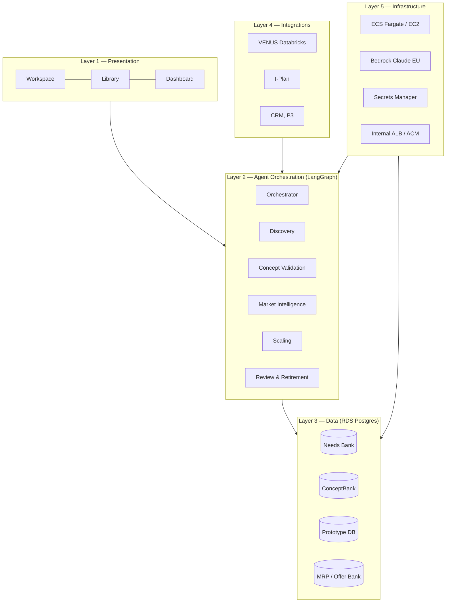
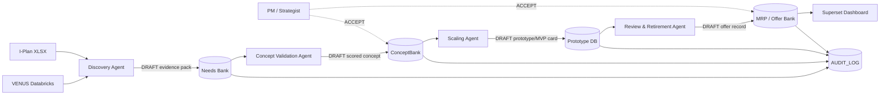
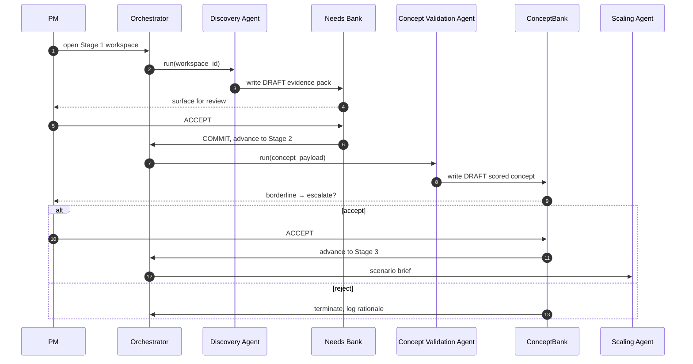
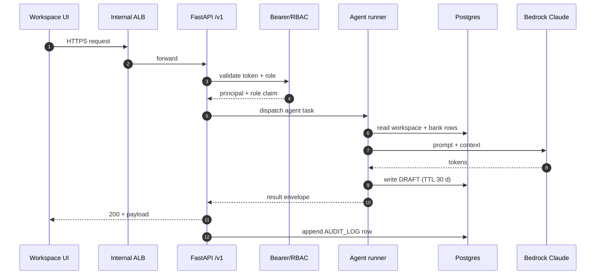
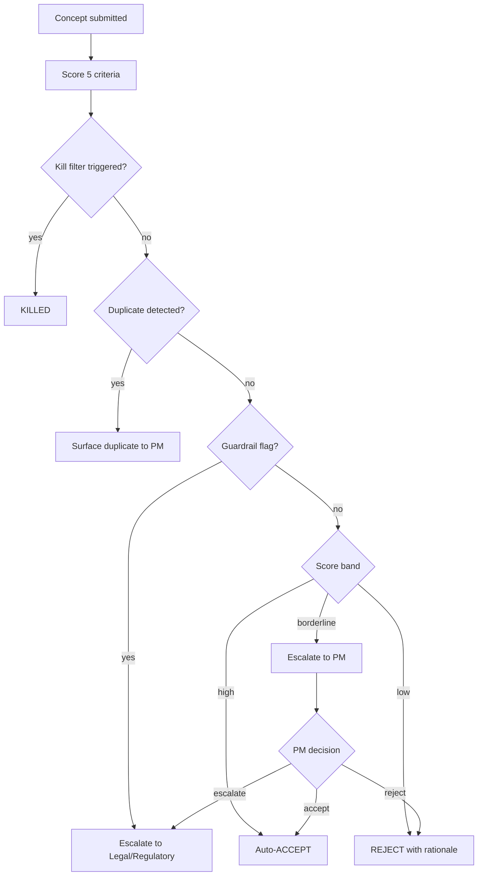
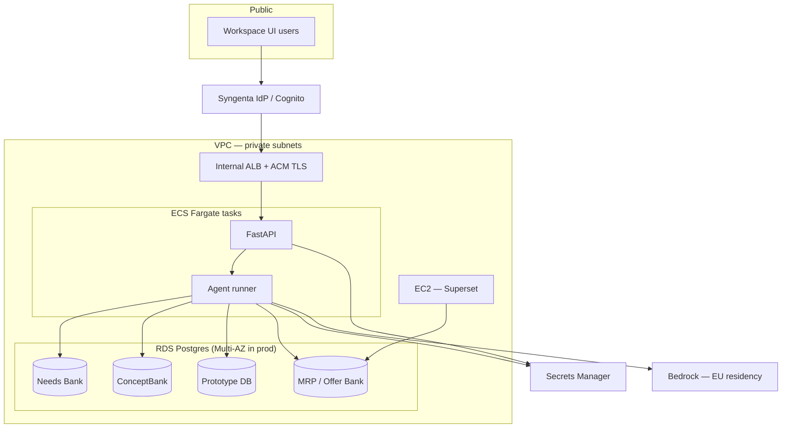

# 8. Architecture Walkthrough

> **Source:** Confluence page `5800427770` in space `DODE`
> **Original URL:** <https://digitial-product-engineering.atlassian.net/wiki/spaces/DODE/pages/5800427770>
> **Diagrams:** all original PNG diagrams are inlined as Mermaid below.

---

*End-to-end walkthrough of the Differentiated Offers Platform. Layers, agents, data schemas, API contracts, runtime configs, error handling, observability, performance, security, deployment. Written for engineers and tech leads joining the build.*

**How to read this page.** Sections 1 to 3 are the conceptual model. Sections 4 to 7 are the implementation contract: API, DB, configs, agents. Sections 8 to 12 are operational concerns: errors, observability, performance, security, deployment.

## Table of contents

/\*<![CDATA[\*/
div.rbtoc1781584559936 {padding: 0px;}
div.rbtoc1781584559936 ul {list-style: disc;margin-left: 0px;}
div.rbtoc1781584559936 li {margin-left: 0px;padding-left: 0px;}
/\*]]>\*/

- [Table of contents](#id-8.ArchitectureWalkthrough-Tableofcontents)
- [1. Big picture in one diagram](#id-8.ArchitectureWalkthrough-1.Bigpictureinonediagram)
- [2. Layer by layer](#id-8.ArchitectureWalkthrough-2.Layerbylayer)
  - [2.1 Layer 1 Presentation](#id-8.ArchitectureWalkthrough-2.1Layer1Presentation)
  - [2.2 Layer 2 Agent orchestration](#id-8.ArchitectureWalkthrough-2.2Layer2Agentorchestration)
  - [2.3 Layer 3 Data](#id-8.ArchitectureWalkthrough-2.3Layer3Data)
  - [2.4 Layer 4 Integrations (read-only)](#id-8.ArchitectureWalkthrough-2.4Layer4Integrations(read-only))
  - [2.5 Layer 5 Infrastructure](#id-8.ArchitectureWalkthrough-2.5Layer5Infrastructure)
- [3. Agent interaction example, Stage 1 to Stage 2](#id-8.ArchitectureWalkthrough-3.Agentinteractionexample,Stage1toStage2)
- [4. API contracts](#id-8.ArchitectureWalkthrough-4.APIcontracts)
  - [4.1 Request flow](#id-8.ArchitectureWalkthrough-4.1Requestflow)
  - [4.2 Endpoint catalogue (Phase 1)](#id-8.ArchitectureWalkthrough-4.2Endpointcatalogue(Phase1))
  - [4.3 Request and response examples](#id-8.ArchitectureWalkthrough-4.3Requestandresponseexamples)
  - [4.4 Standard error shape](#id-8.ArchitectureWalkthrough-4.4Standarderrorshape)
- [5. Database schemas](#id-8.ArchitectureWalkthrough-5.Databaseschemas)
  - [5.1 Needs Bank](#id-8.ArchitectureWalkthrough-5.1NeedsBank)
  - [5.2 Offer Bank](#id-8.ArchitectureWalkthrough-5.2OfferBank)
  - [5.3 ConceptBank](#id-8.ArchitectureWalkthrough-5.3ConceptBank)
  - [5.4 Prototype DB](#id-8.ArchitectureWalkthrough-5.4PrototypeDB)
  - [5.5 Workspaces and timeline (supporting tables)](#id-8.ArchitectureWalkthrough-5.5Workspacesandtimeline(supportingtables))
- [6. YAML config schemas](#id-8.ArchitectureWalkthrough-6.YAMLconfigschemas)
  - [6.1 scoring.yaml](#id-8.ArchitectureWalkthrough-6.1scoring.yaml)
  - [6.2 prompts.yaml](#id-8.ArchitectureWalkthrough-6.2prompts.yaml)
  - [6.3 guardrails.yaml](#id-8.ArchitectureWalkthrough-6.3guardrails.yaml)
  - [6.4 components.yaml](#id-8.ArchitectureWalkthrough-6.4components.yaml)
- [7. Concept Validation decision flow](#id-8.ArchitectureWalkthrough-7.ConceptValidationdecisionflow)
- [8. The 6-stage lifecycle](#id-8.ArchitectureWalkthrough-8.The6-stagelifecycle)
- [9. Error handling matrix](#id-8.ArchitectureWalkthrough-9.Errorhandlingmatrix)
- [10. Observability](#id-8.ArchitectureWalkthrough-10.Observability)
- [11. Performance budgets](#id-8.ArchitectureWalkthrough-11.Performancebudgets)
- [12. Data retention and governance](#id-8.ArchitectureWalkthrough-12.Dataretentionandgovernance)
- [13. Security model](#id-8.ArchitectureWalkthrough-13.Securitymodel)
- [14. Deployment topology](#id-8.ArchitectureWalkthrough-14.Deploymenttopology)
- [15. Open decisions in Phase 1](#id-8.ArchitectureWalkthrough-15.OpendecisionsinPhase1)
- [16. Out of scope for Phase 1](#id-8.ArchitectureWalkthrough-16.OutofscopeforPhase1)

## 1. Big picture in one diagram

> **Diagram:** `do-arch-overview.png` — rewritten as Mermaid



Five layers. The Presentation layer is what users see, the Agent Orchestration layer is where intelligence lives, the Data layer holds the institutional knowledge, the Integrations layer brings external context, and the Infrastructure layer is everything AWS-managed.

## 2. Layer by layer

### 2.1 Layer 1 Presentation

| Surface | Description | Primary users | Phase |
| --- | --- | --- | --- |
| Workspace | Per-offer project environment, 6 stages, agent outputs inline | Commercial teams, Agronomy | Phase 1 (Stages 1-3) |
| Library | Needs Bank + ConceptBank + Offer Bank views | All users | Phase 1 read views, Phase 2 search and export |
| Dashboard | Apache Superset, portfolio analytics | Leadership, Marketing | Phase 1 basic query view, Phase 2 onward |

### 2.2 Layer 2 Agent orchestration

**Design principle:** agents operate asynchronously against persistent databases. No agent blocks the user's workflow. Human gates only at defined points.

#### Orchestrator

- **Tools:** workspace state reader, agent spawner, human escalation trigger, notification dispatcher, stage transition validator.
- **Autonomous actions:** reads workspace state, picks the right agent, aggregates outputs, surfaces a brief.
- **Human escalation triggers:**
  1. Two agents return conflicting recommendations.
  2. Concept score borderline on the kill filter or differentiation (0.4 to 0.6).
  3. Stage gate criteria partially met.
- **Runs:** on every workspace state change event.

#### Discovery Agent

- **Tools:** Needs Bank query, Offer Bank search, VENUS Databricks connector (Phase 2), I-Plan reader, competitor landscape lookup (Phase 2).
- **Autonomous actions:** top 3 pain points by euro/ha, existing offers by archetype + region, draft problem statement with evidence pack.
- **Human escalation:** problem statement requires Commercial validation before stage advances.
- **Re-activation:** concept idle for > 14 days, re-run with fresh data.

#### Concept Validation Agent

- **Tools:** differentiation scorer (5 criteria), kill filter (4 criteria), duplicate detector, guardrails checker.
- **Autonomous actions:** score, kill, surface duplicates.
- **Human escalation:** borderline scores or guardrail flags requiring legal or regulatory review.

#### Market Intelligence Agent (Phase 2)

- **Tools:** pattern detector, stagnation monitor, white-space alerter.
- **Runs:** continuously in background.

#### Scaling Agent (Phase 2)

- **Tools:** regional fit analyser, adaptation brief generator.
- **Runs:** on offer transition to Live.

#### Review Agent (Phase 3)

- **Tools:** annual scheduler, review brief generator.
- **Runs:** annually per offer.

### 2.3 Layer 3 Data

> **Diagram:** `do-data-flow.png` — rewritten as Mermaid



Four AWS RDS Postgres databases. Single instance with four schemas for Phase 1; can split per database for Phase 2 if concurrency grows.

### 2.4 Layer 4 Integrations (read-only)

| System | Used for | Phase 1 | Phase 2 onward |
| --- | --- | --- | --- |
| VENUS Databricks | Market size + SYT share by crop and CU | Manual I-Plan XLSX as proxy | Live connector via Databricks SQL warehouse |
| I-Plan | Sales plan data | One-time XLSX import | Refreshed quarterly via XLSX or API |
| CRM | Customer signals | Not in scope | Phase 3 |

### 2.5 Layer 5 Infrastructure

| Service | Used for |
| --- | --- |
| AWS RDS Postgres | 4 databases, single instance Phase 1, Multi-AZ in prod |
| AWS ECS Fargate or EC2 | FastAPI service + agent runner |
| AWS EC2 | Apache Superset for dashboard |
| AWS Bedrock | Claude under EU data residency |
| AWS Secrets Manager | DB creds, Bedrock config, VENUS token |
| AWS internal ALB | TLS via ACM |

## 3. Agent interaction example, Stage 1 to Stage 2

> **Diagram:** `do-agents-interaction.png` — rewritten as Mermaid



## 4. API contracts

FastAPI service exposes a versioned REST API at `/v1`. OpenAPI served at `/docs`.

### 4.1 Request flow

> **Diagram:** `do-api-flow.png` — rewritten as Mermaid



### 4.2 Endpoint catalogue (Phase 1)

| Verb | Path | Purpose | Auth |
| --- | --- | --- | --- |
| GET | `/healthz` | Liveness probe | Public |
| GET | `/readyz` | Readiness (DB + Bedrock reachable) | Public |
| POST | `/v1/workspace` | Create a new workspace | Bearer |
| GET | `/v1/workspace/{id}` | Fetch workspace state and timeline | Bearer |
| PATCH | `/v1/workspace/{id}/stage` | Advance or rewind stage | Bearer |
| POST | `/v1/workspace/{id}/activate-discovery` | Trigger Discovery Agent | Bearer |
| GET | `/v1/workspace/{id}/brief` | Read the latest agent brief | Bearer |
| GET | `/v1/needs-bank` | List pain points with filter | Bearer |
| GET | `/v1/offer-bank` | List offers with filter | Bearer |
| POST | `/v1/concept` | Submit a concept for validation | Bearer |
| GET | `/v1/concept/{id}` | Get latest validation result | Bearer |
| POST | `/v1/concept/{id}/mvp-card` | Save MVP card (Stage 3) | Bearer |
| GET | `/v1/notifications` | List my notifications | Bearer |
| POST | `/v1/notifications/{id}/ack` | Acknowledge a notification | Bearer |

### 4.3 Request and response examples

#### POST /v1/workspace

```
POST /v1/workspace
Authorization: Bearer dev-static-token
Content-Type: application/json

{
  "name": "Foliar BioStim + Spray Assist for corn FR",
  "owner_role": "commercial_team",
  "archetype": "Product Plus",
  "region": "Continental",
  "country": "FR"
}

201 Created
{
  "workspace_id": "ws_01HXYZ...",
  "stage": "stage_1_active",
  "created_at": "2026-06-04T10:31:00Z"
}
```

#### GET /v1/workspace/{id}/brief

```
GET /v1/workspace/ws_01HXYZ.../brief

200 OK
{
  "workspace_id": "ws_01HXYZ...",
  "stage": "stage_1_complete",
  "discovery_brief": {
    "top_pain_points": [
      {"pain_id": "pn_001", "description": "Inconsistent corn N-uptake mid-season", "value_eur_per_ha": 38},
      {"pain_id": "pn_007", "description": "Late-season chlorosis from soil compaction", "value_eur_per_ha": 22},
      {"pain_id": "pn_012", "description": "Weather-window losses for foliar timing", "value_eur_per_ha": 18}
    ],
    "existing_offers_landscape": [
      {"offer_id": "of_044", "name": "FoliarBio FR", "score": 0.62, "components": ["a","b"]}
    ],
    "problem_statement": "French corn growers lose roughly 38 EUR/ha to inconsistent mid-season N-uptake [pn_001]. Existing offers (of_044) cover this only partially because they do not include precision timing."
  },
  "generated_at": "2026-06-04T10:33:12Z"
}
```

#### POST /v1/concept

```
POST /v1/concept
{
  "workspace_id": "ws_01HXYZ...",
  "problem_statement": "...",
  "archetype": "Product Plus",
  "region": "Continental",
  "components": ["a", "b"]
}

202 Accepted
{
  "concept_id": "cn_01HXYZ...",
  "status": "queued",
  "poll_after_seconds": 5
}
```

#### GET /v1/concept/{id}

```
200 OK
{
  "concept_id": "cn_01HXYZ...",
  "decision": "pass",
  "differentiation_score": 0.72,
  "sub_scores": {
    "customer_value": 0.85,
    "defensibility": 0.60,
    "simplicity": 0.78,
    "compliance": 0.70,
    "scaling_potential": 0.65
  },
  "kill_filter": {"triggered": false, "criteria": []},
  "duplicate_score": 0.42,
  "top_duplicates": [{"offer_id": "of_044", "similarity": 0.42}],
  "guardrails": {"flags": []},
  "decided_at": "2026-06-04T10:34:50Z"
}
```

### 4.4 Standard error shape

```
{
  "error": {
    "code": "invalid_stage_transition",
    "message": "stage_2_complete cannot transition back to stage_1_active",
    "request_id": "req_01HXYZ..."
  }
}
```

## 5. Database schemas

### 5.1 Needs Bank

```
CREATE TABLE needs_bank (
  pain_id              uuid PRIMARY KEY DEFAULT gen_random_uuid(),
  crop                 text NOT NULL,
  country              char(2) NOT NULL,
  category             text NOT NULL CHECK (category IN ('a','b','c','d','e','f')),
  pain_value_eur_per_ha numeric(10,2) NOT NULL,
  description          text NOT NULL,
  source               text NOT NULL,
  validated_at         timestamptz,
  validator            text,
  active               boolean NOT NULL DEFAULT true,
  created_at           timestamptz NOT NULL DEFAULT now(),
  updated_at           timestamptz NOT NULL DEFAULT now()
);
CREATE INDEX ON needs_bank (crop, country);
CREATE INDEX ON needs_bank (category);
```

### 5.2 Offer Bank

```
CREATE TABLE offer_bank (
  offer_id          uuid PRIMARY KEY DEFAULT gen_random_uuid(),
  name              text NOT NULL,
  archetype_code    text NOT NULL,
  region            text NOT NULL,
  country           char(2),
  component_codes   text[] NOT NULL,
  score             numeric(3,2),
  status            text NOT NULL DEFAULT 'active',
  lifecycle_state   text NOT NULL DEFAULT 'live'
                    CHECK (lifecycle_state IN ('draft','live','retired')),
  created_at        timestamptz NOT NULL DEFAULT now(),
  updated_at        timestamptz NOT NULL DEFAULT now()
);
CREATE INDEX ON offer_bank (archetype_code, region);
CREATE INDEX ON offer_bank (lifecycle_state);
CREATE INDEX ON offer_bank USING GIN (component_codes);
CREATE UNIQUE INDEX unique_active_offer
  ON offer_bank (archetype_code, region, (md5(array_to_string(component_codes,','))))
  WHERE lifecycle_state = 'live';
```

### 5.3 ConceptBank

```
CREATE TABLE concepts (
  concept_id            uuid PRIMARY KEY DEFAULT gen_random_uuid(),
  workspace_id          uuid NOT NULL REFERENCES workspaces(workspace_id),
  problem_statement_ref uuid,
  differentiation_score jsonb,
  kill_filter_result    jsonb,
  duplicate_score       numeric(3,2),
  top_duplicates        jsonb,
  guardrail_flags       jsonb,
  decision              text CHECK (decision IN ('pass','kill','borderline','escalate')),
  decided_at            timestamptz,
  decided_by            text,
  created_at            timestamptz NOT NULL DEFAULT now()
);
CREATE INDEX ON concepts (workspace_id);
CREATE INDEX ON concepts (decision);
```

### 5.4 Prototype DB

```
CREATE TABLE prototypes (
  prototype_id      uuid PRIMARY KEY DEFAULT gen_random_uuid(),
  concept_id        uuid NOT NULL REFERENCES concepts(concept_id),
  mvp_card          jsonb NOT NULL,
  test_results      jsonb,
  field_validations jsonb,
  created_at        timestamptz NOT NULL DEFAULT now(),
  updated_at        timestamptz NOT NULL DEFAULT now()
);
```

### 5.5 Workspaces and timeline (supporting tables)

```
CREATE TABLE workspaces (
  workspace_id  uuid PRIMARY KEY DEFAULT gen_random_uuid(),
  name          text NOT NULL,
  owner_role    text NOT NULL,
  archetype     text NOT NULL,
  region        text NOT NULL,
  country       char(2),
  stage         text NOT NULL DEFAULT 'stage_1_active',
  created_at    timestamptz NOT NULL DEFAULT now(),
  updated_at    timestamptz NOT NULL DEFAULT now()
);

CREATE TABLE workspace_events (
  event_id     uuid PRIMARY KEY DEFAULT gen_random_uuid(),
  workspace_id uuid NOT NULL REFERENCES workspaces(workspace_id),
  event_type   text NOT NULL,
  payload      jsonb,
  actor        text NOT NULL,
  occurred_at  timestamptz NOT NULL DEFAULT now()
);
CREATE INDEX ON workspace_events (workspace_id, occurred_at);
```

## 6. YAML config schemas

### 6.1 scoring.yaml

```
differentiation:
  criteria:
    - id: customer_value
      weight: 0.30
      description: How much pain does this concept solve in EUR per ha
    - id: defensibility
      weight: 0.20
      description: How hard to copy by competitors
    - id: simplicity
      weight: 0.15
      description: How easy to deploy and use
    - id: compliance
      weight: 0.15
      description: Regulatory and ESG fit
    - id: scaling_potential
      weight: 0.20
      description: Cross-country reach potential
  thresholds:
    kill_below: 0.40
    borderline_low: 0.40
    borderline_high: 0.60

kill_filter:
  criteria:
    - id: no_validated_need
      description: No matching pain in Needs Bank
    - id: not_regulatory_feasible
      description: Regulatory blocker known
    - id: no_commercial_fit
      description: No market segment with sufficient size
    - id: no_internal_capability
      description: Syngenta cannot deliver this
```

### 6.2 prompts.yaml

```
agents:
  discovery:
    model_id: anthropic.claude-3-haiku-20240307-v1:0
    temperature: 0.2
    max_tokens: 1200
    system_prompt: |
      You are the Discovery Agent for the Differentiated Offers Platform.
      Your tools are query_needs_bank and search_offer_bank.
      Draft a problem statement that cites pain ids in brackets, e.g. [pn_001].
      Never invent pain ids. If retrieval is empty, return a refusal.
    output_schema_ref: discovery_brief.schema.json

  concept_validation:
    model_id: anthropic.claude-3-haiku-20240307-v1:0
    temperature: 0.0
    max_tokens: 800
    system_prompt: |
      You are the Concept Validation Agent.
      Score the concept per scoring.yaml weights.
      Never compute differentiation in prose, call the differentiation_scorer tool.
    output_schema_ref: validation_result.schema.json
```

### 6.3 guardrails.yaml

```
refusal_rules:
  - id: claim_unverified_regulatory_approval
    pattern_keywords: ["approved by", "registered for"]
    action: refuse
    message: I cannot verify regulatory approval claims. Surface evidence in the workspace.

escalation_rules:
  - id: legal_review_required
    when:
      any_of:
        - region == "EU"
          components contains "f"   # carbon / sustainability
    target_role: legal_reviewer

  - id: regional_lead_review
    when:
      duplicate_score: ">= 0.85"
    target_role: regional_lead
```

### 6.4 components.yaml

```
components:
  - code: a
    name: Foundation
    examples: [Herbicide, Insecticide, Fungicide, Biostimulant, Bionutrition, Seeds]
  - code: b
    name: Precision Advisor
    examples: [Spray Assist, NDVI, disease models, remote scouting]
  - code: c
    name: Shared Success
    examples: [Subscription services]
  - code: d
    name: Risk Shield
    examples: [Yield guarantees, weather-linked risk sharing]
  - code: e
    name: Investment Enabling
    examples: [Credit, barter, loyalty rebates]
  - code: f
    name: Future Ready Farming
    examples: [ESG, soil health, carbon documentation]
```

## 7. Concept Validation decision flow

> **Diagram:** `do-validation-decision.png` — rewritten as Mermaid



## 8. The 6-stage lifecycle

> **Diagram:** `do-stage-lifecycle.png` — rewritten as Mermaid

```mermaid
stateDiagram-v2
    [*] --> Discovery
    Discovery: Stage 1 — Discovery<br/>Discovery Agent
    ConceptValidation: Stage 2 — Concept Validation<br/>CV Agent
    Prototype: Stage 3 — Prototype / MVP card
    Pilot: Stage 4 — Pilot
    Scale: Stage 5 — Scale<br/>Scaling Agent
    Live: Stage 6 — Live<br/>Review & Retirement
    Retired: Retired
    Killed: Killed (kill filter)

    Discovery --> ConceptValidation: evidence accepted
    ConceptValidation --> Prototype: PM ACCEPT
    ConceptValidation --> Killed: kill filter
    Prototype --> Pilot: Strategist APPROVE
    Pilot --> Scale: pilot success
    Scale --> Live: Strategist FINAL APPROVE
    Live --> Live: annual review
    Live --> Retired: retire decision
    Killed --> [*]
    Retired --> [*]
```

Phase 1 covers Stages 1 + 2 with agents. Stage 3 is basic non-agentic in Phase 1. Stages 4 to 6 land in Phase 2 + 3.

## 9. Error handling matrix

| Failure mode | Surface | Behaviour | User-visible message |
| --- | --- | --- | --- |
| Bedrock unavailable | Discovery or Concept Validation Agent | Retry 3x with backoff, then surface "AI service temporarily unavailable" + leave workspace in current stage | "AI is taking longer than usual. Your workspace is saved." |
| Postgres unavailable | Any layer | FastAPI returns 503, UI shows retry-banner | "Service is recovering. Retry in 30 seconds." |
| Needs Bank empty for query | Discovery Agent | Return refusal with "no matching pain points found", suggest broadening filters | "No pain points match this crop + country combination. Try a broader category." |
| Differentiation score borderline | Concept Validation Agent | Decision = borderline, escalate to named human reviewer | "This concept needs a human review. Notification sent to [reviewer]." |
| Guardrail triggered | Concept Validation Agent | Decision = escalate, target role notified | "This concept involves regulated topics. Routed to legal for review." |
| Duplicate at similarity 1.0 | Concept Validation Agent | Decision = escalate, show the duplicate | "This appears to be a duplicate of existing offer [offer]. Pivot or merge?" |
| YAML config invalid | Agent startup | Fail fast with line + reason | (operator console only) |
| Stage transition invalid | FastAPI | 422 with reason | "Cannot move to this stage from current stage." |

## 10. Observability

| Signal | What | Tool |
| --- | --- | --- |
| Logs | Structured JSON to stdout. `request_id`, `workspace_id`, `agent_id`, `level`, `msg`, `duration_ms`. | CloudWatch Logs (Phase 1), Datadog (Phase 2) |
| Traces | OTEL traces from FastAPI through agents to Bedrock. | X-Ray (Phase 1), Datadog APM (Phase 2) |
| Metrics | `workspace.created_total`, `concept.validated_total{decision}`, `agent.invocation_duration_ms{agent_id}`, `bedrock.tokens_total{agent_id}`, `bedrock.cost_usd`. | CloudWatch metrics |
| Alerts | p95 agent invocation > 10s sustained 5 min; Bedrock error rate > 5%; workspace creation drop > 50% week-over-week. | CloudWatch alarms to Slack |
| Audit | Every workspace event in `workspace_events`. Every Commercial Expert sign-off logged. | SQL queryable |

## 11. Performance budgets

| Target | Value |
| --- | --- |
| Workspace creation p95 | under 200 ms (excludes agent activation) |
| Needs Bank query p95 | under 100 ms |
| Offer Bank search p95 | under 150 ms |
| Discovery Agent end-to-end p95 | under 10 seconds |
| Concept Validation Agent end-to-end p95 | under 8 seconds |
| Bedrock invocation cost per concept | under 0.10 EUR (Claude Haiku) |
| Concurrent active workspaces in Phase 1 | under 20 (2 pilot teams) |
| Workspace event throughput | under 10 per second |

## 12. Data retention and governance

| Data | Retention | Policy |
| --- | --- | --- |
| Needs Bank rows | Indefinite, soft delete via `active=false` | Authoritative knowledge layer |
| Offer Bank rows | Indefinite, lifecycle\_state retired = read-only | Portfolio history |
| Concepts | Indefinite (Phase 1), revisit at Phase 3 with legal | Innovation history |
| Workspace events | Indefinite (audit) | Per row may be redacted on legal request |
| Bedrock prompts and outputs | 90 days in logs, then aggregate-only | Cost + debugging trade-off |
| Pilot user identities | Pseudonymise after Phase 1 ends | Privacy |

## 13. Security model

- **EU data residency:** Bedrock invocation uses Frankfurt or Dublin endpoints. RDS in eu-west or eu-central. S3 buckets EU only.
- **Network isolation:** RDS in private subnets. Compute in private subnets. Internal ALB only.
- **Secrets:** AWS Secrets Manager only. IRSA per task role.
- **Auth (Phase 1):** static bearer token per team, rotated monthly. Roles are env flags only.
- **Auth (Phase 3):** RBAC with roles Offer Owner, Custodian, Steward, Stakeholder. Row-level security in Postgres.
- **Audit:** every workspace event logged. Phase 3 adds full audit log + signed timestamps.
- **Configs as code:** scoring rules, prompts, guardrails versioned in git. CODEOWNERS require Commercial Expert review on scoring + components changes.

## 14. Deployment topology

> **Diagram:** `do-deployment.png` — rewritten as Mermaid



## 15. Open decisions in Phase 1

1. **LangGraph vs AWS Step Functions.** ADR landing end of Week 2.
2. **One RDS instance vs four.** Default one instance with four schemas. Re-evaluate at Phase 2.
3. **Bedrock model pinning.** Default Claude Haiku for cost; revisit Sonnet if quality requires.
4. **Workspace UI stack.** React or Next.js. Default Next.js if SSR needed for Library views.
5. **Pilot team selection.** 1 Oceanic + 1 South East. Specific teams chosen by Product Owner with Commercial Expert input.
6. **Dashboard initial query view.** Phase 1 can be a single Superset page or simple FastAPI endpoint.

## 16. Out of scope for Phase 1

- VENUS Databricks live feed (manual I-Plan XLSX import proxy).
- Market Intelligence Agent, Scaling Agent, Review Agent.
- Full Leadership Dashboard.
- Finance & Trading (e) full compliance workflow.
- Carbon / Sustainability (f) full MRV verification.
- RBAC (simple role flags only).
- Email notifications (in-app only).
