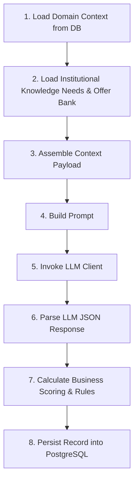

# Backend Architecture & System Design (Phase 1 POC)

Detailed technical architecture guide explaining the design principles, agent orchestration model, component patterns, provider abstractions, and technology choices.

---

## 1. Architectural Philosophy

The Differentiated Offers AI Platform is designed as an **autonomous, agentic, domain-driven backend**. Unlike traditional web applications that rely on static form-based wizards, this platform delegates analytical workflows to specialist AI agents.

### Core Principles
1. **Autonomous Agent Execution**: Agents process context, calculate metrics, check guardrails, and execute pipeline stages autonomously. Human intervention is required only at explicit decision gates (e.g. borderline scoring verdicts).
2. **Deterministic Guardrails + Generative Intelligence**: Generative LLMs generate insights and problem statements, but business verdict decisions (e.g. `pass`, `kill`, `borderline`, `escalate`) are calculated using deterministic Python logic and hardcoded weights.
3. **Immutability & Auditability**: Every major stage transition persists structured JSONB output to PostgreSQL and logs an audit record to `workspace_events`.
4. **Decoupled Provider Abstraction**: LLM interaction is isolated behind an abstract interface (`BaseLLMProvider`), enabling seamless switching between LLM providers (e.g. OpenAI, Anthropic, or Local/Mock) without modifying agent business logic.

---

## 2. Technology Rationale

### Why FastAPI?
- **ASGI Performance**: Built on Starlette and Pydantic, providing high throughput for asynchronous I/O operations.
- **Automatic OpenAPI Contracts**: Generates interactive Swagger documentation (`/docs`) directly from Pydantic type annotations.
- **Python Ecosystem**: Direct access to scientific libraries, database drivers, and LLM SDKs without wrapper overhead.

### Why PostgreSQL?
- **Relational Integrity**: Enforces strict foreign key constraints between workspaces, discoveries, concepts, and prototypes.
- **Native JSONB Support**: Combines relational schemas for structured metadata with JSONB columns for flexible agent outputs (differentiation scores, blueprint component breakdowns, audit payloads).
- **Check Constraints**: Native database-level check constraints ensure invalid enum strings (e.g. `decision` or `status`) are rejected at the database layer.

### Why Raw SQL (`psycopg` v3)?
- **Zero ORM Overhead**: Eliminates ORM query generation ambiguities, N+1 query traps, and session tracking complexities.
- **Explicit Parameterization**: 100% of queries use `%s` positional parameterization, preventing SQL injection vulnerabilities.
- **Direct Connection Control**: Uses `psycopg.connect` with `row_factory=dict_row` to return clean dictionary rows directly compatible with Pydantic schemas.

---

## 3. Specialist Agent Architecture

Every specialist agent inherits from `app.agents.base_agent.BaseAgent` and implements an 8-step execution pipeline:



### Phase 1 Implemented Specialist Agents

#### 1. DiscoveryAgent (`app/agents/discovery_agent.py`)
- **Stage**: Stage 1 Discovery & Needs Validation
- **Responsibilities**: Queries `workspaces`, `needs_bank`, and `offer_bank` to formulate customer pain point research and problem statement drafts.
- **Output**: Persists record into `discoveries` table with problem statement and recommended offer archetype.

#### 2. ConceptAgent (`app/agents/concept_agent.py`)
- **Stage**: Stage 2 Concept Development & Validation
- **Responsibilities**: Evaluates concept cards against Stage 1 discoveries; calculates composite differentiation score using documented business rules:
  $$\text{Composite Score} = (0.35 \times \text{farmer\_value}) + (0.30 \times \text{commercial\_viability}) + (0.20 \times \text{feasibility}) + (0.15 \times \text{strategic\_fit})$$
  Applies kill filter rules, duplicate checking against ConceptBank, and assigns verdict (`pass` if score $\ge 6.5$, `kill`, `borderline`, `escalate`).
- **Output**: Persists record into `concepts` table.

#### 3. PrototypeAgent (`app/agents/prototype_agent.py`)
- **Stage**: Stage 3 Offer Prototype & Blueprinting
- **Responsibilities**: Generates 6-component offer blueprint for passed Stage 2 concepts across core building blocks:
  1. `core_product` (Herbicide/Insecticide/Fungicide/Seeds)
  2. `digital_service` (Digital agronomic advisory)
  3. `advisory` (F2F expert consulting)
  4. `risk_guarantee` (Yield protection / risk transfer)
  5. `financial_structure` (Credit/barter terms)
  6. `sustainability` (Low environmental impact formulation)
- **Output**: Persists record into `prototypes` table with `status='draft'`.

---

## 4. LLM Provider Abstraction Layer

```mermaid
graph TD
    Agent[Specialist Agent] --> Client[LLMClient]
    Client --> Strategy{Select Provider}
    Strategy -->|LLM_PROVIDER="openai"| OpenAI[OpenAIProvider]
    Strategy -->|No API Key / Test Mode| Mock[Mock Response Fallback]
    
    OpenAI --> Base[BaseLLMProvider Interface]
    Mock --> Base
```

The provider abstraction layer (`app/llm/`) enforces a clean contract:
```python
class BaseLLMProvider(ABC):
    @abstractmethod
    def generate(self, prompt: str) -> str:
        """Execute prompt against provider and return raw text response."""
        pass
```
- **Network Resilience**: Implements 30-second network timeouts.
- **Mock Fallback**: In test environments or when `OPENAI_API_KEY` is missing, `OpenAIProvider` returns structured mock JSON strings, enabling 100% offline unit testing without external API calls.
