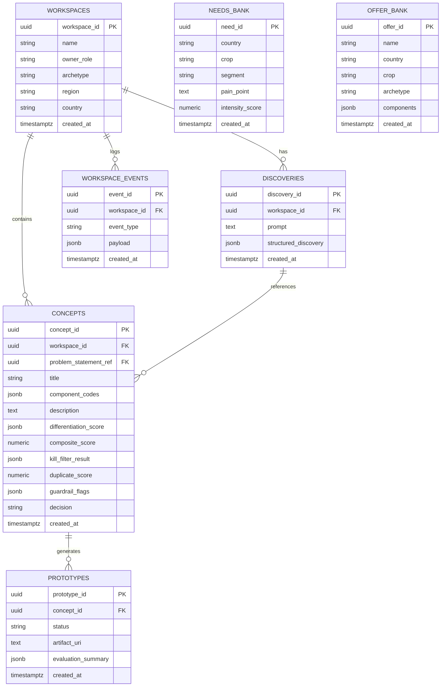

# Database Documentation (Phase 1 POC)

Comprehensive database schema documentation, ER diagram, table specifications, constraints, and data flow for PostgreSQL.

---

## Entity-Relationship (ER) Diagram



---

## Table Specifications

### 1. `workspaces`
Stores commercial offer development project spaces.
- `workspace_id`: `UUID PRIMARY KEY DEFAULT gen_random_uuid()`
- `name`: `VARCHAR(255) NOT NULL`
- `owner_role`: `VARCHAR(100)`
- `archetype`: `VARCHAR(100)`
- `region`: `VARCHAR(100)`
- `country`: `VARCHAR(10)`
- `created_at`: `TIMESTAMPTZ DEFAULT CURRENT_TIMESTAMP`

### 2. `discoveries`
Stores Stage 1 Discovery problem statement outputs and LLM research prompts.
- `discovery_id`: `UUID PRIMARY KEY DEFAULT gen_random_uuid()`
- `workspace_id`: `UUID REFERENCES workspaces(workspace_id) ON DELETE CASCADE`
- `prompt`: `TEXT`
- `structured_discovery`: `JSONB NOT NULL`
- `created_at`: `TIMESTAMPTZ DEFAULT CURRENT_TIMESTAMP`

### 3. `concepts`
Stores Stage 2 Concept evaluation cards, composite scores, and verdict decisions.
- `concept_id`: `UUID PRIMARY KEY DEFAULT gen_random_uuid()`
- `workspace_id`: `UUID REFERENCES workspaces(workspace_id) ON DELETE CASCADE`
- `problem_statement_ref`: `UUID REFERENCES discoveries(discovery_id)`
- `title`: `VARCHAR(255)`
- `component_codes`: `JSONB`
- `description`: `TEXT`
- `differentiation_score`: `JSONB`
- `composite_score`: `NUMERIC(5,2)`
- `kill_filter_result`: `JSONB`
- `duplicate_score`: `NUMERIC(5,2)`
- `guardrail_flags`: `JSONB`
- `decision`: `VARCHAR(20) CHECK (decision IN ('pass', 'kill', 'borderline', 'escalate'))`
- `created_at`: `TIMESTAMPTZ DEFAULT CURRENT_TIMESTAMP`

### 4. `prototypes`
Stores Stage 3 Offer Prototype blueprints across the 6 offer building blocks.
- `prototype_id`: `UUID PRIMARY KEY DEFAULT gen_random_uuid()`
- `concept_id`: `UUID REFERENCES concepts(concept_id) ON DELETE CASCADE`
- `status`: `VARCHAR(20) CHECK (status IN ('draft', 'testing', 'validated', 'rejected'))`
- `artifact_uri`: `TEXT`
- `evaluation_summary`: `JSONB NOT NULL`
- `created_at`: `TIMESTAMPTZ DEFAULT CURRENT_TIMESTAMP`

### 5. `needs_bank`
Stores validated customer pain points collected across European agricultural markets.
- `need_id`: `UUID PRIMARY KEY DEFAULT gen_random_uuid()`
- `country`: `VARCHAR(10)`
- `crop`: `VARCHAR(100)`
- `segment`: `VARCHAR(100)`
- `pain_point`: `TEXT NOT NULL`
- `intensity_score`: `NUMERIC(3,1)`
- `created_at`: `TIMESTAMPTZ DEFAULT CURRENT_TIMESTAMP`

### 6. `offer_bank`
Stores historical and live commercial offer definitions with component tagging.
- `offer_id`: `UUID PRIMARY KEY DEFAULT gen_random_uuid()`
- `name`: `VARCHAR(255) NOT NULL`
- `country`: `VARCHAR(10)`
- `crop`: `VARCHAR(100)`
- `archetype`: `VARCHAR(100)`
- `components`: `JSONB NOT NULL`
- `created_at`: `TIMESTAMPTZ DEFAULT CURRENT_TIMESTAMP`

### 7. `workspace_events`
Stores immutable audit trail events for agent execution and platform decisions.
- `event_id`: `UUID PRIMARY KEY DEFAULT gen_random_uuid()`
- `workspace_id`: `UUID REFERENCES workspaces(workspace_id) ON DELETE CASCADE`
- `event_type`: `VARCHAR(100) NOT NULL`
- `payload`: `JSONB NOT NULL`
- `created_at`: `TIMESTAMPTZ DEFAULT CURRENT_TIMESTAMP`

---

## Data Flow Across Tables

```
[Commercial Team Creates Workspace]
          │
          ▼
     workspaces (workspace_id)
          │
          ├─────────────────────────────────────────┐
          ▼                                         ▼
[Stage 1 Discovery Agent]                 needs_bank & offer_bank (Read)
          │
          ▼
     discoveries (discovery_id)
          │
          ▼
[Stage 2 Concept Validation Agent]
          │
          ▼
      concepts (concept_id, decision: pass/kill/borderline/escalate)
          │
          ▼ (If decision == 'pass')
[Stage 3 Prototype Agent]
          │
          ▼
     prototypes (prototype_id, status: draft)
          │
          ▼
 workspace_events (Audit Trail)
```
